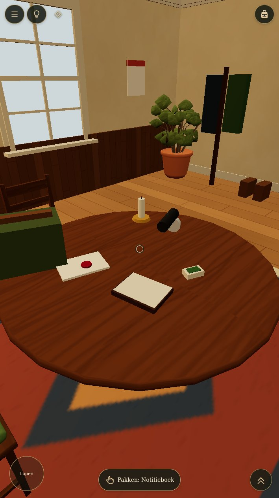
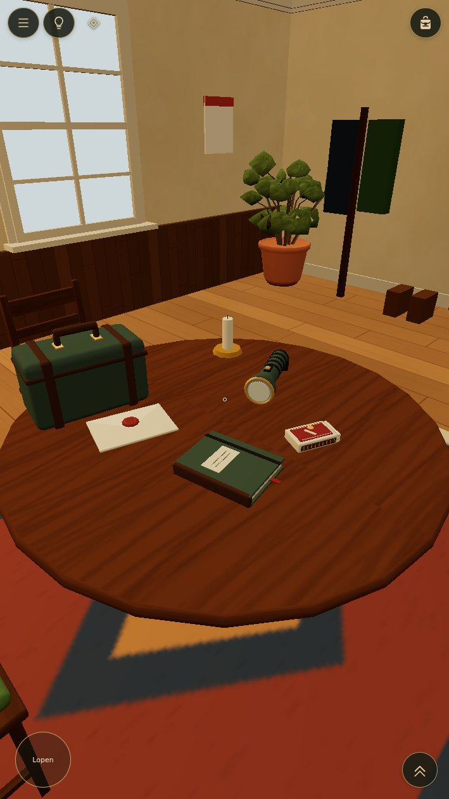
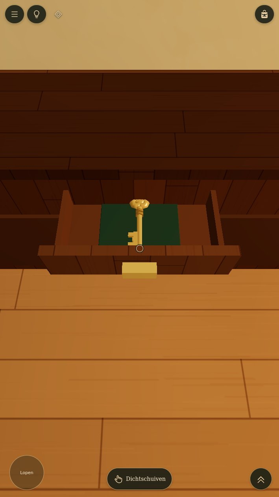
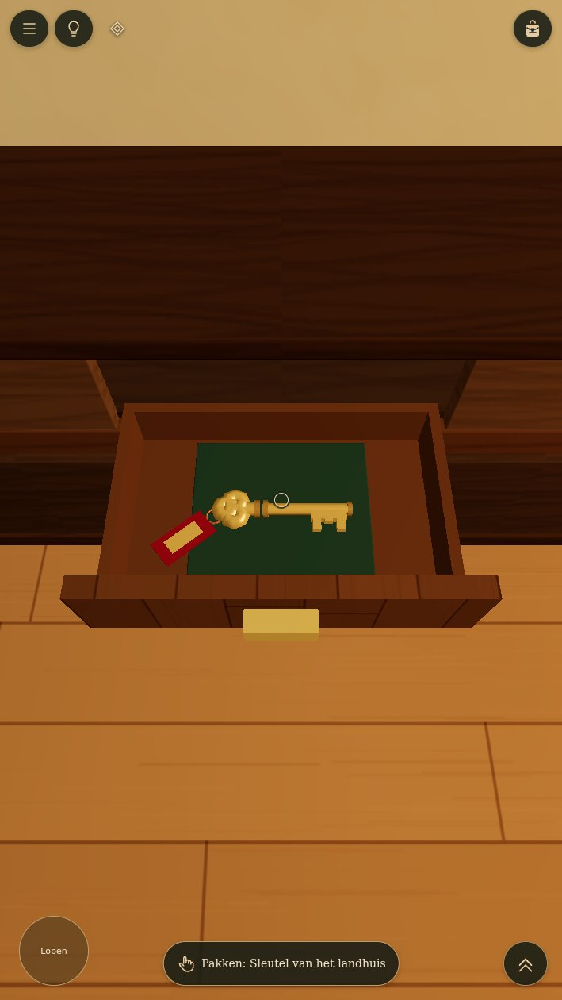
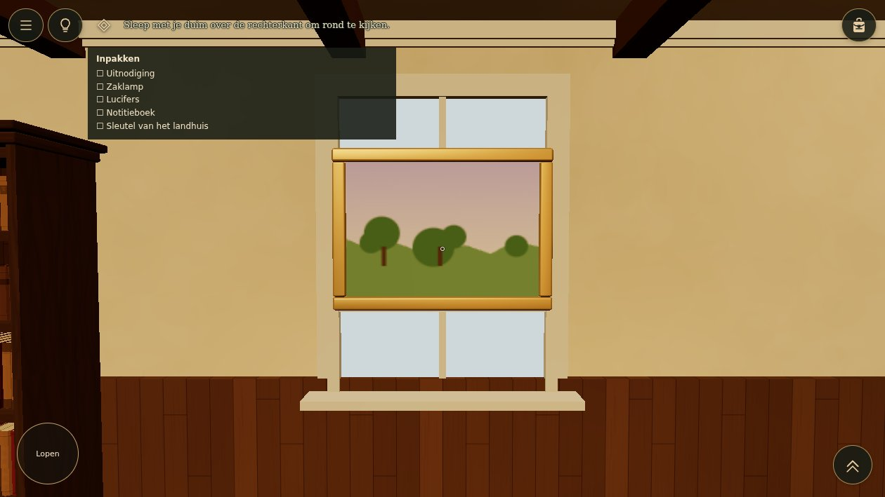
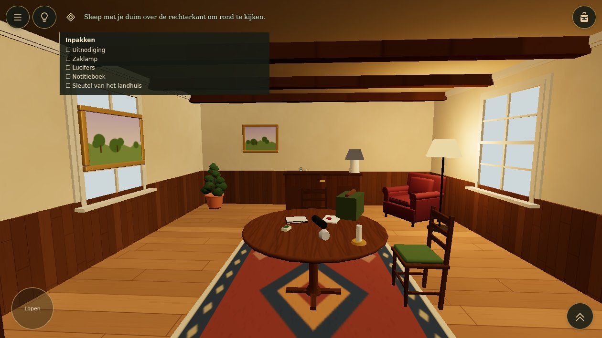

# TUT-R01 — start-room comparison

Actual in-engine captures, with matched camera, lighting, quality and item state.
Portrait: 709×1260; landscape: 1260×709; DPR 1. Chromium headless shell / SwiftShader.
These are visual and render-cost evidence, not physical-phone FPS validation.

## Table

| Before | After |
| --- | --- |
|  |  |

The flashlight now has a connected reflector, lens, barrel, grip and switch. Matches have a sleeve,
tray, strikers and a match emblem. The notebook has a bound cover, pages and elastic. The travel
case has straps, clasps and an open handle; it remains decorative.

## Drawer

| Before | After |
| --- | --- |
|  |  |

The cabinet has an empty drawer cavity; the drawer extends far enough to expose the liner.
The approved key is presented sideways so the full silhouette clears the front lip.

## Window and wall art

| Before | After |
| --- | --- |
|  |  |

The painting has moved to solid wall and uses existing FLW-D2 art. Wainscot ends below the sill,
and the lower sash is complete.

## Room

| Before | After |
| --- | --- |
|  |  |

[Implementation, reference provenance, costs and integration check](../TUT-R01.md).
[Before counters](before/results.json) · [After counters and six passed tutorial checks](after/results.json).

Owner visual review is pending. No production merge or deployment is included.
