# TUT-R02 — complete start-room quality pass

Real matched in-engine captures. The baseline is the live TUT-R01 + PB01 build at `5ca306d`.
The revised version completes the remaining home asset families and reviews the whole scene.

Portrait 709×1260; landscape 1260×709; DPR 1. Chromium headless shell / SwiftShader.
These images are not physical-phone FPS validation. [Scope, asset-by-asset decisions and validation](../TUT-R02.md).

## Kapstok, jassen en schoenen

| Before | After |
| --- | --- |
| 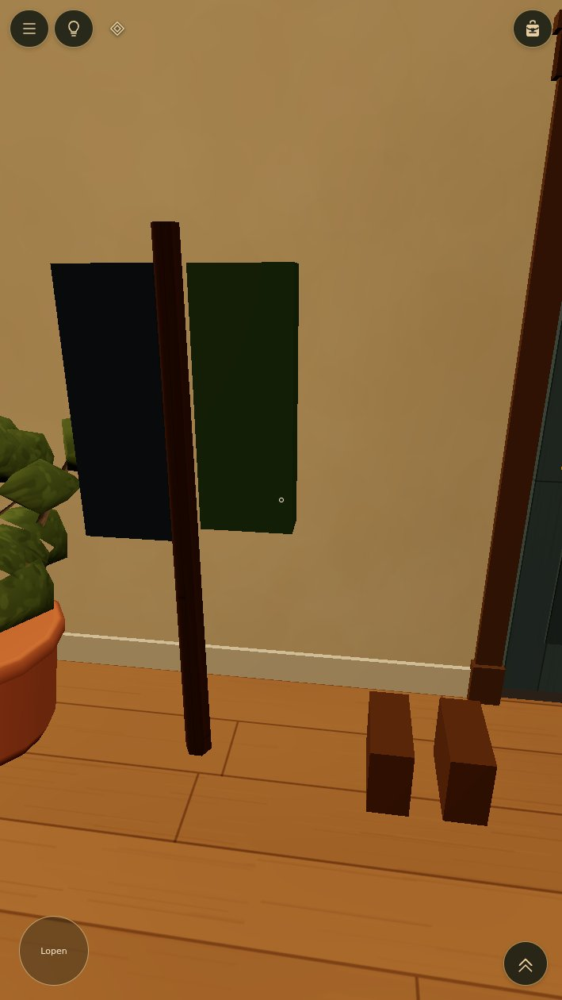 | 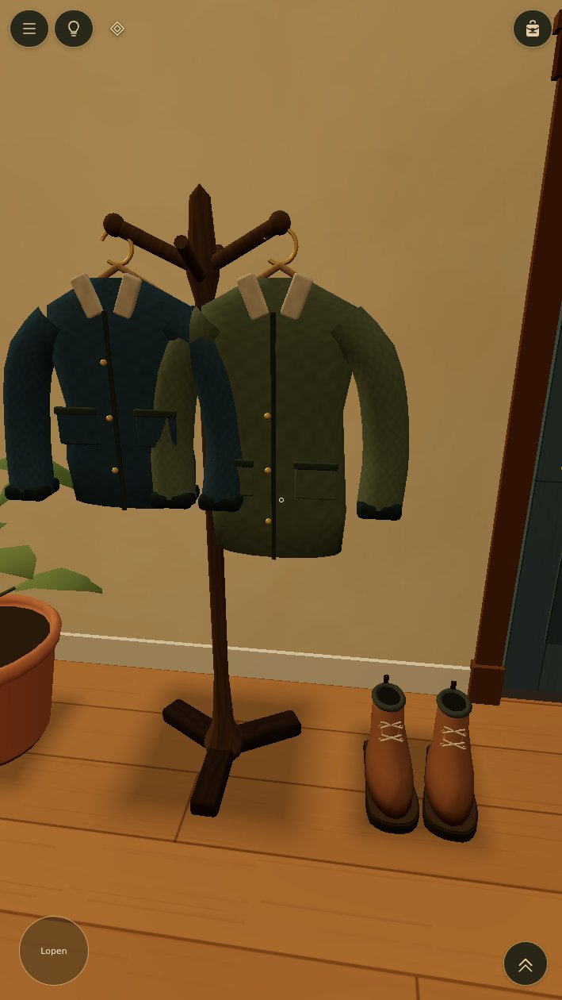 |

## Schoenvorm

| Before | After |
| --- | --- |
| 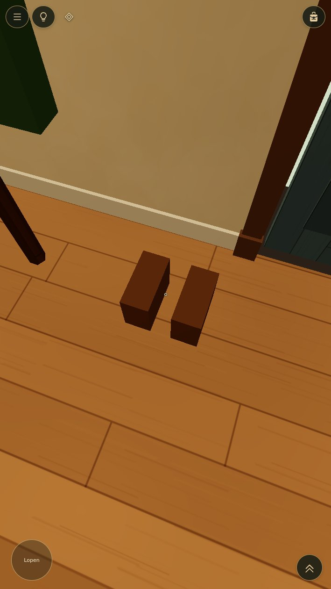 | 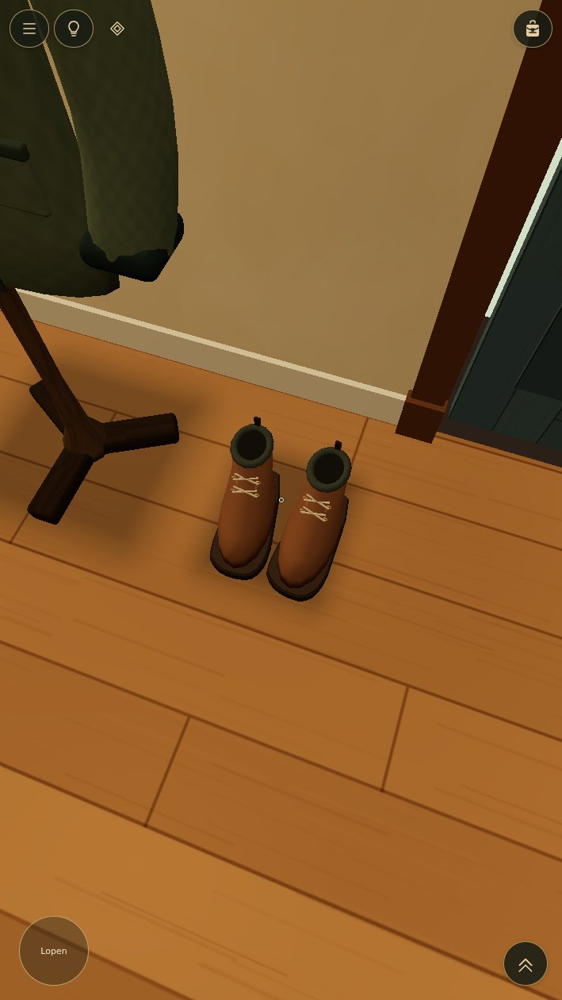 |

## Kalender

| Before | After |
| --- | --- |
| 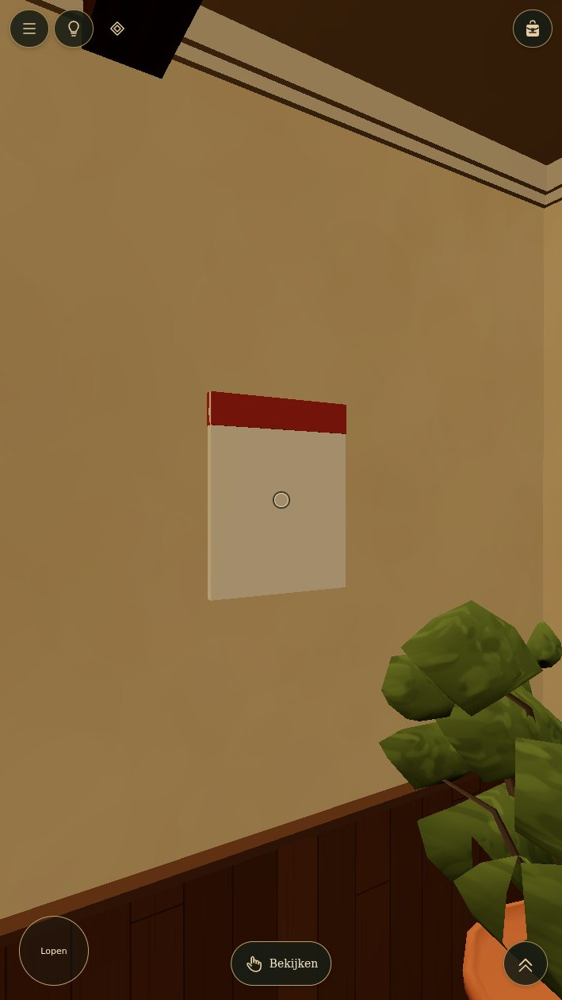 | 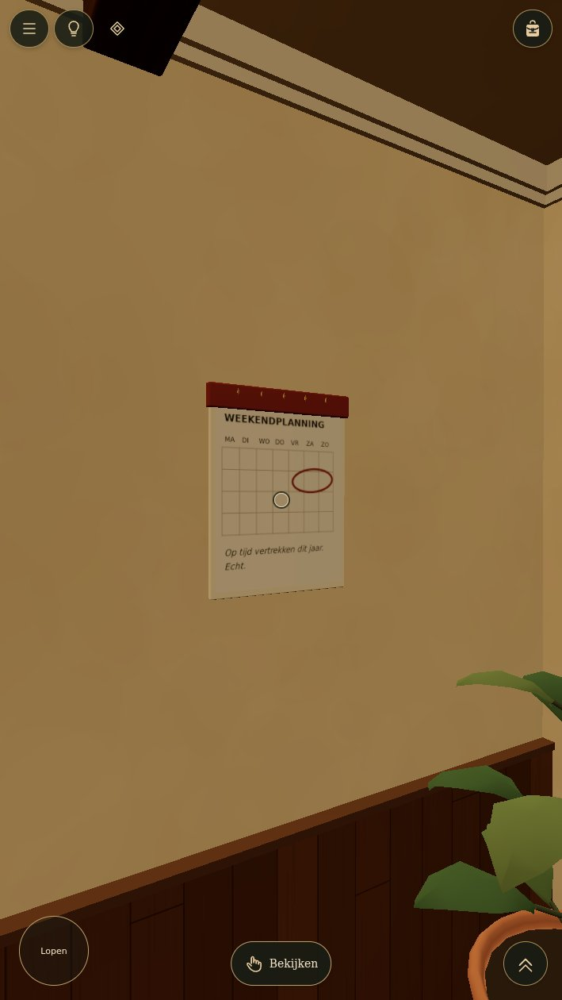 |

## Lamp

| Before | After |
| --- | --- |
| 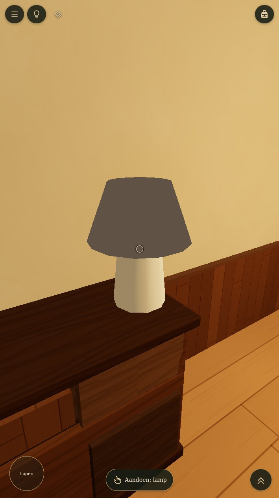 | 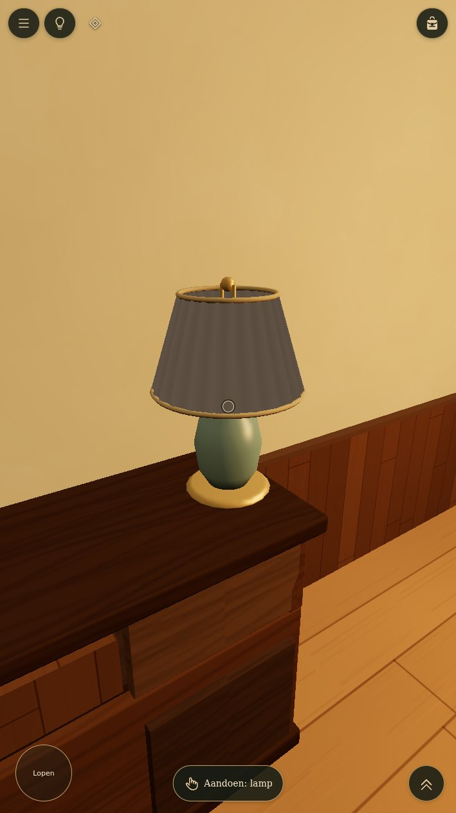 |

## Gehele kamer

| Before | After |
| --- | --- |
| 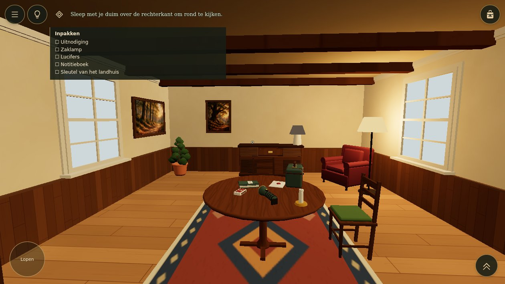 | 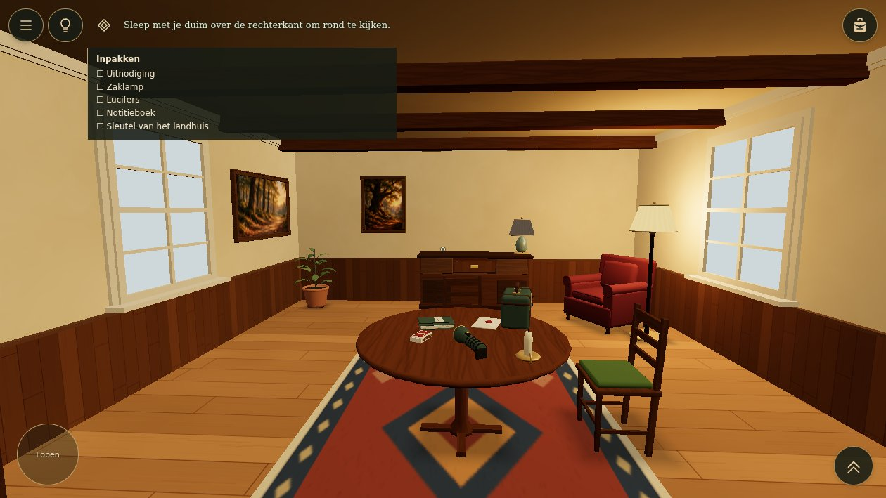 |

## Starttafel en kaars

| Before | After |
| --- | --- |
| 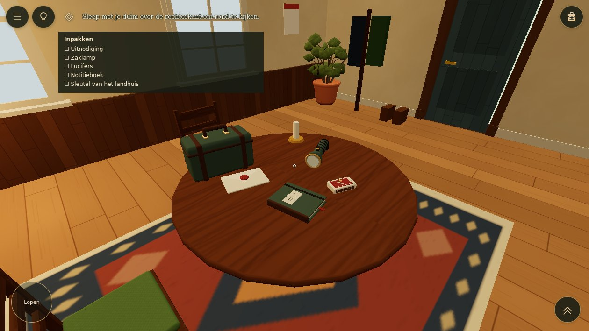 |  |

## Lade en sleutel

| Before | After |
| --- | --- |
|  |  |

## Raamwand

| Before | After |
| --- | --- |
|  | 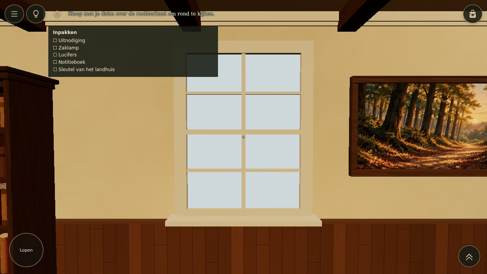 |

Owner visual review pending; this follow-up is not yet deployed. Existing tutorial mechanics and approved R01 assets are retained.
