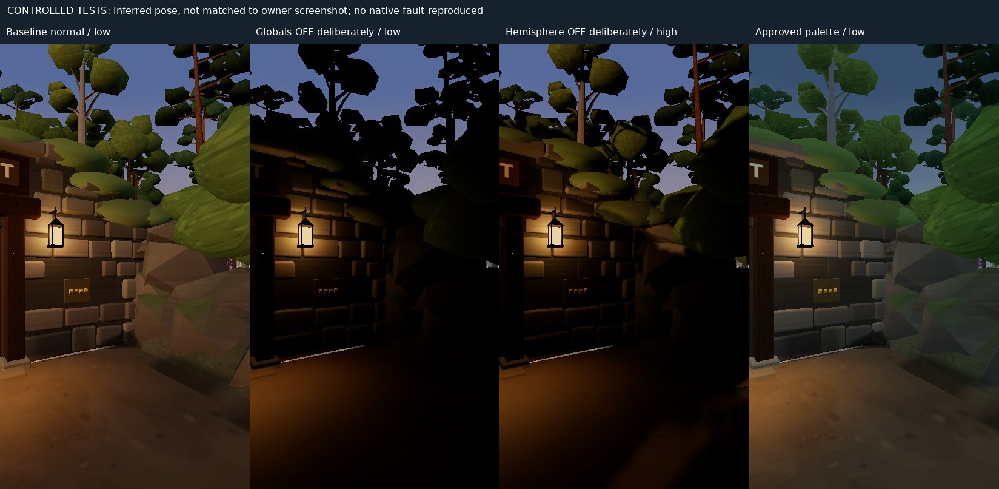

# ENV-L01 — owner approval and black-render screenshot follow-up

13 October 2026. Owner approved **all four atmospheres** (daylight, golden afternoon, blue hour, late dusk). Colour palettes are unchanged. This approves the visual direction; no merge or production deployment authorised or performed.

## New evidence

Owner attachment `82052.jpg` was actually read and inspected. Original phone/browser bars are not republished to public GitHub; the attachment remains in the conversation. [Pixel analysis / provenance](evidence/owner-screenshot-analysis.json) records its SHA256, size and diagnostic ROI.

**OBSERVED:** blue/slate sky and HUD remain visible; most trees/ground/foreground structures are black or near black; isolated foliage surfaces, a luminous lantern and the lock retain colour/value. Black tree silhouettes occlude the visible sky, so at least those objects are being drawn. This is materially more severe than the ordinary production dusk captured in the first audit.

Selected ROI x=0…709, y=410…1235 (825 rows, excluding top HUD text and lower joystick): encoded-JPEG luma median **0**, **87.49%** at <=8/255. The ROI still contains some sky and objects; it is not semantic segmentation, physical luminance, or a matched-camera comparison to the earlier frames. Its numbers do not identify a cause.

Current published game was fetched directly: embedded build **ae2a036 · 2026-10-12**, still with the legacy positive hemisphere/directional formulas and authored surface shader. [Served-build verification](evidence/served-build-check.json). Screenshot build, cache, quality, exact pose, renderer and progress value remain unknown.

## Revised diagnosis

- **CONFIRMED:** the owner's symptom exists in the supplied image. It is no longer merely a verbal report. The severe defect is still **not reproduced natively** on the available renderer and its cause remains unconfirmed.
- **INFERRED, priority:** a failure in global light contribution or a shared lit-shader path is consistent with black surfaces while sky/emissive elements survive. Colour in some foliage does **not** prove point lights are functioning; it may come from directional or local illumination. Do not diagnose a missing HemisphereLight from the picture alone.
- **INFERRED:** ordinary dusk calibration is an inadequate explanation for the breadth of black surfaces, given the positive source light values and intact software reference. Pure distance culling is also inadequate for the silhouettes that visibly cover sky. Neither statement rules out other runtime/driver issues.
- **UNRESOLVED:** high-vs-low shader/shadow path, global light visibility/uniform upload, material/shader variants/precision, batching path and the exact cached build. High-quality shadows normally affect direct light, not hemisphere fill; a dark high-quality result alone would not identify the fault.

## Controlled tests — deliberate fault injection, not an Android reproduction

Real game, inferred BOSLUST-near pose (x63, feet at support height, z13.5, yaw33°, pitch0), 412×733 DPR1, coarse pointer, preview t=0.85, torch off. **This is not the owner's exact pose.** Nine capture records (including a repeated normal reference after restoring material defines) isolate low/high normal, globals-off, hemisphere-off low/high, hemisphere-only, authored surfaces off, and pilot. [Measurements](evidence/owner-followup-measurements.json).

Turning globals off deliberately produces widespread dark/black surroundings while sky and lantern presentation remain. Removing hemisphere produces black-facing/shadowed areas but retains many sunlit surfaces; high adds direct shadows. Neither forced variant duplicates every feature of the owner screenshot or proves the corresponding fault actually occurred. Normal reference remains readable. Material surface shader can now be disabled and exactly restored using the sandbox panel; no production material pipeline change.

## Device diagnosis controls added to the isolated review

`?review=lighting` → ENV-L01 panel:

- **Only local lights (test):** zeros global sun/fill deliberately. Reference only, never a repair.
- **Without authored surface shader:** removes the FLW_SURFACE defines, then restores their exact originals when another diagnostic is selected. Geometry, textures and other defines remain.
- **Download render diagnosis:** exports `ENV-L01-render-report.json`: build, camera, quality/DPR, actual review mode/value, exposure, scene-light visibility/values, linked cached-program global-light uniforms, GPU/precision/capability information and GL diagnostics.

The report excludes the saved game, inventory, puzzle flags and personal storage. It is downloaded locally, not uploaded or sent. Cached programs include unused variants; the report must be interpreted together with the image. Reading GL error samples/clears that error flag. [Software export smoke check](evidence/report-export-check.json): report downloaded/parsed, 88 linked programs, no GL/page/shader errors; puzzle flags unchanged.

### Validation scope

Latest diagnostic code: typecheck/build pass, **273 unit tests pass**. Browser UI selections, surface restore, normal references and JSON download exercised in the nine captures; no console/page errors. Original full E2E 102/103, DEV-04C 22/22 and DEV-04D 18/18 remain results of the earlier committed prototype, not reruns of this addendum. No phase palette, ordinary game light value, save/progression logic or world geometry changed. The extra review diagnostics add about 1.42 kB gzip relative to the first prototype; no ordinary-frame shader work is added.

## Smallest next step on the owner's phone

1. In the currently published game, select **Low** quality, reload and take a screenshot from the same spot. Keep the same save and torch state. Note whether High was selected for the supplied image and record the build from Pause.
2. If the scene remains black on Low, compare the existing production `?multidraw=0` fallback at the same spot, with the same save; this is already available without merging ENV-L01.
3. If/when the isolated branch is served for device review, capture normal/hemisphere-only/without-surface-shader frames and download a report. The current production URL does not yet contain the new lighting review or its report button.

Keep root-cause repair and final integration blocked until device evidence narrows the fault. The four-phase art direction is accepted and should not be re-darkened to imitate the faulty screenshot.
