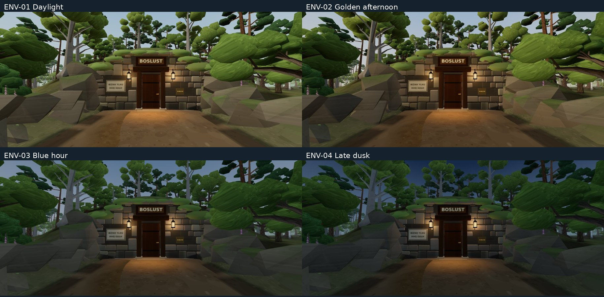
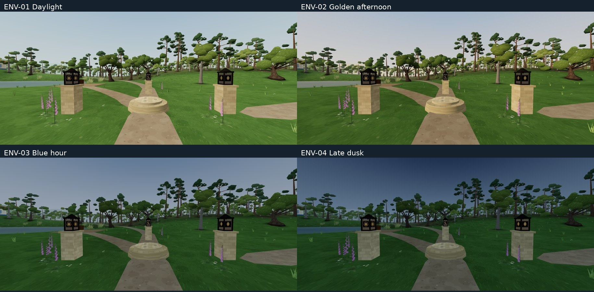
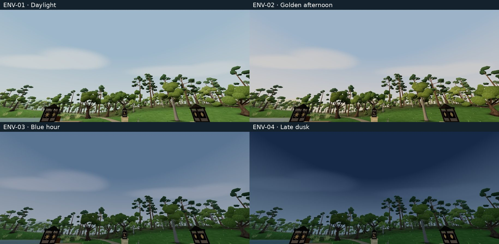
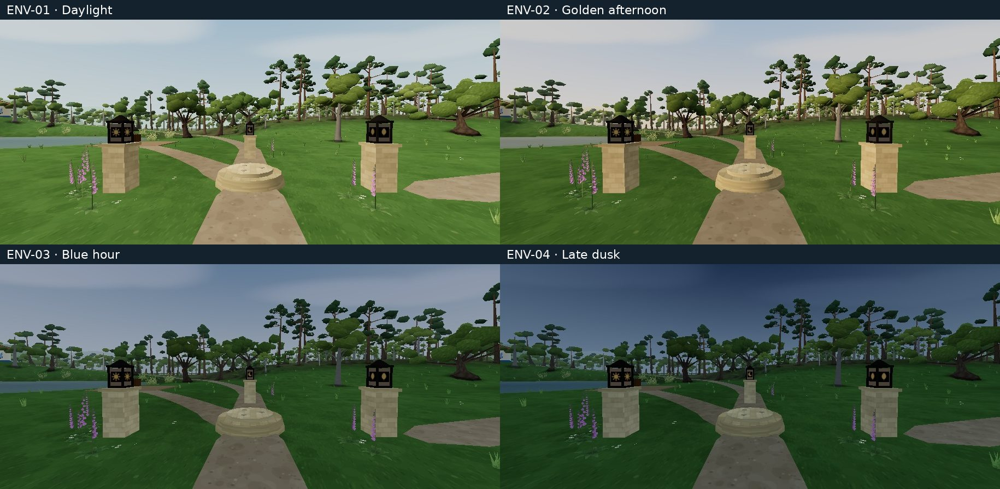
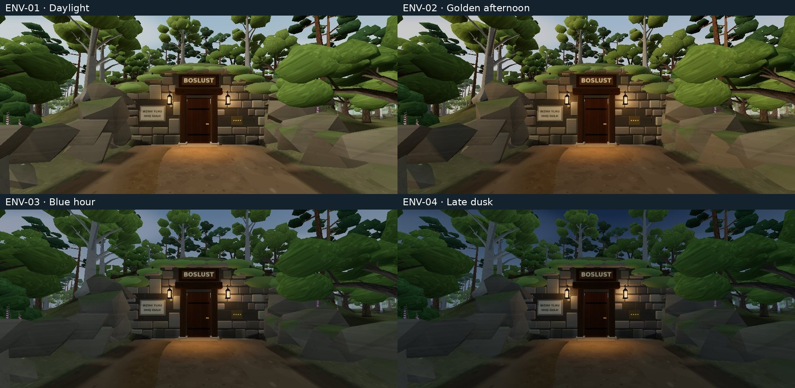
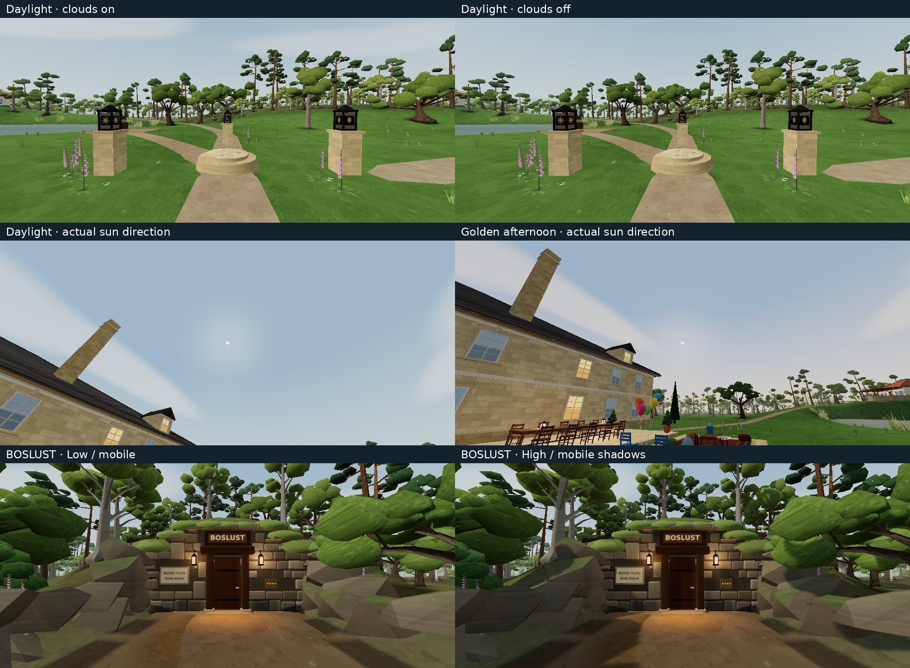
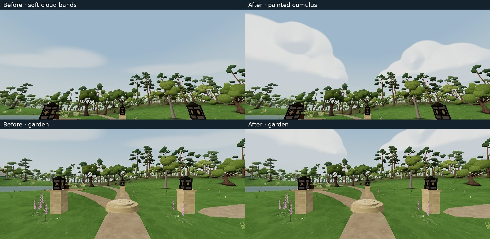
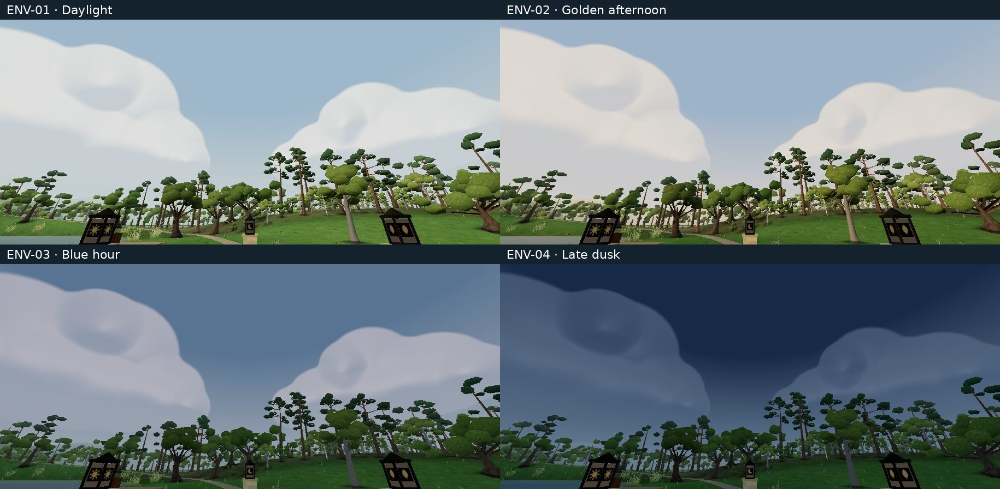

> Owner review — 13 October 2026: all four atmospheres approved as a visual direction. Device defect diagnosis, physical Android QA, integration, merge and deployment remain separate gates.

> Current status — 14 October 2026: owner-approved cumulus and four-phase lighting are enabled in normal estate gameplay on this isolated branch. Earlier opt-in/baseline statements below describe historical prototype stages. See [release and recovery assessment](ENV-L01_RELEASE_ASSESSMENT.md). Nothing merged or deployed by ENV-L01.

# ENV-L01 — owner visual review

**Prototype, not production.** Eight fixed poses, 63 original-production diagnostic frames + 71 four-phase pilot frames, eight same-world path-control frames and eight desktop-aspect frames, condensed into sheets rather than committing duplicate raw collections. All scenes are genuine Three.js screenshots; no image generation, repainting or colour editing. Sheets only resize/layout original pixels and add captions. Geometry, materials, front-door state and torch-off state are retained.

## Start with these

Read each four-up left-to-right, top-to-bottom: daylight, golden afternoon, blue hour, late dusk. Same exact player/camera pose within each set; no claim these match the owner Android screenshot, whose pose is unknown.

## Evidence index

| Sheet | Conditions and purpose |
|---|---|
| [Before / after](evidence/before-after.jpg) | BOSLUST and garden; production dusk vs pilot late dusk; low, 915×412 |
| [Other locations / interiors](evidence/targeted-evening.jpg) | Rows: approach, manor, deep woodland, hall, living, darker Sterrenkamer. Columns: production dusk / blue hour / late dusk; low |
| [Low / high](evidence/quality-boslust.jpg) | Daylight low/high, late dusk low/high. Daytime high has directional shadows; after sunset no direct shadow pass, but pool remains 4 vs 3 |
| [Desktop](evidence/desktop.jpg) | 1280×720 low, same-world production lighting vs pilot at both endpoints; desktop aspect adds eight actual frames |
| [Portrait](evidence/portrait.jpg) | BOSLUST daylight/dusk, garden daylight/dusk; low, 412×915 |
| [BOSLUST diagnostics](evidence/diagnostics-boslust.jpg) | Original production t=1, component variants. `clay` is a uniform-grey override with practical effects retained; do not interpret it as fully isolated clay |
| [Woodland diagnostics](evidence/diagnostics-woodland.jpg) | Original production: normal, hemisphere-only, directional-only, neutral white. Directional-only reproduces black shadow-facing geometry; this does not demonstrate missing fill on Android |

Exact pose, camera, room, counters, quality, renderer and diagnostic labels are recorded in [baseline](evidence/baseline-measurements.json) and [prototype](evidence/prototype-measurements.json) measurements. Raw filenames identify the source frame behind each sheet cell; raw full frames remain local/reproducible, not a second version-controlled screenshot collection. [Paired measurements](evidence/paired-measurements.json) isolate baseline/pilot in one loaded world and prove the LOD-history budget caveat.

Chromium headless shell 141, SwiftShader WebGL2, DPR 1, FOV 68; 915×412 landscape and 412×915 portrait. This is phone-sized desktop/software rendering, not Android emulation or hardware verification. High uses desktop 2048 shadow maps; real coarse-pointer mobile high uses 1024. Fixed poses resolve feet to existing collision support. Only front door open; reduced motion on; no flashlight; normal saved-puzzle flags are not used to force phases.

Capture build was created with `8f2eac9 + working tree`, subsequently committed unchanged as local `de1ef37` / remote `6d4df3619679706720dd734344c5c158ebf164d7` (identical Git tree); [build fingerprint](evidence/prototype-build.json) records its actual JS bundle and runtime-source hashes. Final QA rebuilt the committed source independently and guards its bundle against overlapping rebuilds. No screenshot from the old VCP-01 globe pilot was borrowed.

## Critical visual assessment

**Observed:** sunset warmth is selective rather than an orange overlay; evening stonework/path edges retain form; woodland trunks and midground separate better from cool haze. Practical lights stay the warm attention points at BOSLUST and the manor. The deeper route is navigable in these stationary frames without torch light. Indoor walls become more neutral/cool while fireplaces remain warm. The darker room remains quieter than the hall, but its ceiling/props become more legible.

**Remaining judgement:** low quality has no sun shadows by design, so lawn/daylight can still look flat and rather bright green. Sky is currently a clean gradient with restrained disc/glow, no clouds; it can feel sparse in the open lawn. Blue hour's horizon is slate/grey and may need a little more authored rose-grey, but stronger colour should be reviewed on the phone first. Late dusk is intentionally less dark than a physical night. Do not darken it simply to make the two evening states more different.

**Limits:** no motion video of every route, no physical Android measurements, no actual display brightness/thermal assessment, and no estate-wide audit of newly readable secrets through existing vegetation gaps. Solid-door/through-wall gameplay tests and culling logic are unchanged; brighter fill cannot create geometry transparency, but it can reveal an object previously concealed only by darkness. That requires owner play review.

## Owner decisions before any further work

1. Is blue hour the right main evening mood, or should its ambient colour be slightly bluer/less grey?
2. Is late dusk comfortably navigable on the Samsung without the torch, including the deep woodland route?
3. Does daylight retain the welcoming ART-01 identity, or feel too flat/green on low quality?
4. Do interiors keep enough warmth and hierarchy, especially living hearth vs unlit darker room?
5. The original severe-black screenshot has been received; please supply its build/quality/progress if known. In this branch's isolated review, capture BOSLUST/bospad at t=1 with **Production**, then **Vier fasen**, then **Hemisphere only**, same camera/orientation. This is the smallest useful device isolation step for the still-unconfirmed black-out.

Recommendation: use ENV-03 as the main evening anchor, retain the cool ground-bounce floor and local warm lamps, and review ENV-04 on-device before further darkening. Keep ACES/exposure 1.15. Do not merge, deploy or undertake final estate-wide calibration until the owner has reviewed these results and the device issue is narrowed.

Owner image has now been inspected; direction accepted. [Screenshot follow-up and device diagnosis](ENV-L01_OWNER_SCREENSHOT_FOLLOWUP.md).

## Sky detail continuation — 13 October 2026

Owner requested further sky development after approving the four atmospheres. **25 new real game frames**, separate from the earlier 159, use one existing sky dome, optional thin clouds and refined sun presentation. Same exact camera/geometry within each four-phase set. This does not reproduce or repair the Android blackout, which the owner reports cleared after reload.

### Capture conditions and index

[Exact per-frame poses, lighting, fog, counters, shader/GL diagnostics and bundle fingerprints](evidence/sky-detail-measurements.json). Chromium headless shell 141, ANGLE SwiftShader WebGL2, coarse pointer/touch browser, DPR1. Landscape 915×412 / FOV68; portrait 412×915 / FOV82. Torch off; review state with front door open. Three timings after four warmup renders are software timings, not Android performance. Fixed room blend for still comparisons; no saved puzzle flags changed. The two portrait endpoint frames and entrance-hall/cloud-off regression are indexed in that JSON; raw frames are scratch capture outputs, not a duplicate repository collection.

Sheets: `sky-detail-four-phases.jpg` looks upward from the garden to expose cloud form; `sky-detail-garden.jpg` and `sky-detail-boslust.jpg` keep the initial representative viewpoints; `sky-detail-controls.jpg` shows paired day cloud on/off, the actual day/golden sun directions and Low/High daytime BOSLUST.

**Observed:** distinct cool evening gradients retain path, foliage and stone readability. Clouds are soft elongated bands, strongest in day/golden, subtle in late dusk; no fantasy glow or moon. Baseline cloud toggles produce identical JPEG frames. Pilot garden toggles leave the bottom 30% foreground pixels identical at both endpoints, while the sky changes. Entrance-hall JPEG differences are small but nonzero; successive capture ticks also advance existing animated practicals, so do not claim pixel-identical indoor renders. Global light/counter pairs are equal.

**Review decision:** recommend retaining the restrained cloud bands and clear-sky switch. Sky/fog/world palette remains as approved. Review the additional cloud shape and sun treatment separately: is it sufficiently painterly and natural, or should the optional clouds be lighter/clearer? Android frame pacing and the intermittent native defect remain outstanding. No final estate-wide tuning, merge or deployment performed.

Latest source checks and regression provenance: 274 units and typecheck/build pass; main 102/103 (only F05), DEV-04C 22/22, DEV-04D 18/18. See [latest QA](ENV-L01_QA_REPORT.md#sky-continuation--latest-build-validation-13-october-2026). These software captures and suites do not certify physical Android performance or the intermittent native fault.

## Current review — more pronounced cumulus

Owner requested billowing forms closer to the supplied screenshot. Current clouds have rounder silhouettes, brighter upper faces and cool undersides. Palette/exposure/world lighting remain as approved. These are actual game captures; the reference itself is not treated as implementation evidence.

[Current 25-frame index / exact conditions / counters / source and bundle hashes](evidence/cumulus-measurements.json): same harness, fixed poses, Low and mobile High, portrait endpoints, garden/upward sky/BOSLUST/solar views/hall and cloud on/off. Earlier soft-cloud records retain their earlier build provenance. No root-cause repair claim or device-performance approval.

Recommendation: use this more readable painted cumulus silhouette as the next cloud anchor; evaluate cloud scale and coverage on a phone before adding fine detail. Strong cloud forms and unchanged direct sunlight still use an artistic approximation, without cloud-shadow simulation. Native fine edge texture/scattering from the reference is not reproduced by this analytic shader.
