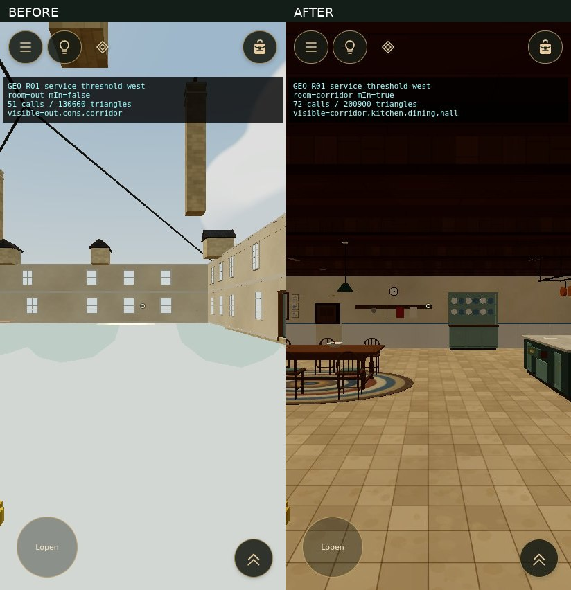

# GEO-R01 — Building Integrity Repair

The disappearing kitchen/service interiors shown in `82159.mp4` are reproduced and repaired. The implementation and focused validation are complete for the available footage. Coverage of `82158.mp4` remains pending because attachment delivery failed; that video has not been inspected.

Branch: `geo-r01-building-integrity`. Production baseline: `fe74db0b471d7816d840e6c223b92950adf5639f`. No merge or deployment is authorized.

## Causes and repairs

| Confirmed defect | Cause and code | Focused repair |
| --- | --- | --- |
| Interior vanishes while turning in the kitchen/service doorway; same class at the Copacabana doorway | Wall-depth thresholds fall outside all room rectangles. `World.updateCulling()` in `src/interactions/world.ts` treats the camera as outdoors and its angular doorway test hides `mIn`, including floors, partitions and ceilings. Reproduced at plan X107.9/Z102.5 looking west, matching the video's early empty-house view. | `src/world/rooms.ts` supports localized threshold ownership; `src/world/roomdefs.ts` assigns the two actual opening footprints to the existing corridor room. No room IDs or partitions moved. |
| Actual floor, ceiling and partition gaps beside the main manor wall | Service-wing surfaces stop at X108.4, while the main manor's outer wall face is X108.0. Raw geometry probes confirm the missing 40 cm strip even with geometry visibility ignored. | In `src/world/manor.ts`, extend the existing floor, support floor, ceiling and two partitions to X108.0. Match room classification to the existing wall face. Existing materials and construction methods remain. |
| Empty exterior or culled corridor seen through closed glass | Closed transparent doors are treated as opaque graph edges, and physical glass colliders block visual culling rays. | Explicit `seeThrough` portal metadata; register glass doors and conservatory panes in a visual-only pass-through set (`props.ts`, `conservatory.ts`). Preserve movement collision and interaction occlusion. From outdoors, a closed glass portal contributes interior visibility only when its own aperture is in view and unobstructed. |

No evidence of inverted normals or a camera near-plane defect at these repaired locations: front-face floor/ceiling rays and partition rays from both sides succeed after repair, and the camera near plane remains within the player capsule radius. Opaque door, wall and pick occlusion remain active. Existing region/chunk limits, portal depth, vegetation settings and material sidedness remain intact. The exposed sky in the empty-house reproduction was caused by the missing interior ceiling render, not a need to make the whole roof double-sided.

## Review evidence

- [Three defect comparisons](comparison.jpg): disappearing kitchen, true floor gap, closed-glass exterior.
- `before/` and `after/`: 17 corresponding normal-render poses each, with room/region/cost diagnostics overlaid. The overlay is injected by the test harness only.
- `before/results.json`, `after/results.json`: poses, room membership, submitted draw/triangle counts and geometry probes.
- `provenance.json`: source video hash, baseline commit, capture script and compiled-bundle fingerprints.

## Validation

- Typecheck and production build passed. Build retains the existing large-bundle warning.
- **281 unit tests passed**, including six GEO-R01 regressions for thresholds, wing bounds, closed glass, retained structural batches, physical glass collision and exterior occlusion.
- **48 focused browser checks passed**, including 324 lateral/turn/pitch samples, 18 paired floor/ceiling probes, 12 partition probes from both sides, and open traversal both ways plus closed collision for service, Copacabana west/east and kitchen garden doors. No page or WebGL errors.
- The same focused harness on the unchanged production baseline fails six check groups, including threshold ownership, all 18 wing seam probes and all 12 partition-join probes. Final repair passes all groups; these expected baseline failures are retained in `before/results.json`.
- Existing DEV-04A browser suite: **17 checks passed** against the initial structural repair, including all 45 registered passages, surface ownership, two-way exterior crossings, targeting and ID/save invariants. Its final budget-page reload timed out. The full suite is not reported as green. That measurement was recovered separately in fresh browsers on production and the final repair.
- The first collision-test attempt stood in the closing leaf's sweep; the existing safety behavior delayed closure. The final harness settles doors away from their sweep and verifies the collider is enabled before testing blocked traversal.

## Rendering costs and PB01

Measured with Chromium/SwiftShader; these are render submission counts, **not physical Android timing or a device-validated budget**. The focused comparison uses low quality, 412×820 DPR1; existing reference measurements use 1280×720. Full counts are in [render-costs.md](render-costs.md).

| View | Before calls / triangles | After calls / triangles |
| --- | ---: | ---: |
| Kitchen threshold looking west | 51 / 130,660 | 72 / 200,900 |
| Copacabana threshold looking west | 105 / 270,438 | 147 / 331,722 |
| Corridor through closed glass | 41 / 122,418 | 102 / 226,113 |
| Existing conservatory deck view | 140 / 206,548 | 170 / 307,740 |
| Existing front forecourt | 134 / 207,234 | 134 / 207,234 |
| Existing sauna access | 145 / 226,184 | 145 / 226,184 |

The increases restore geometry genuinely visible through the opening/glass. A measured intermediate regression drew service content behind opaque manor walls; the final per-aperture exterior sightline check removes it. Thirteen of fourteen existing reference measurements are unchanged; the conservatory deck now includes the previously hidden corridor. The largest focused view is 331,722 triangles.

PB01 became remote-visible during closeout: `pb01-mobile-development-budget` at `e298649515e80af914da2f3f6fbf51f0ba11f809`. Its provisional ceiling is **750,000 mobile-low camera triangles**, with the **150 draw-call guide unchanged**; device validation is pending and the policy is not yet integrated into production. Its status, `docs/PERFORMANCE_BUDGET.md` and central module were read without changing that branch.

All measured GEO-R01 views fit the provisional triangle ceiling. The existing conservatory deck reaches **170 calls**, exceeding the 150-call guide by **20**; its triangle growth is 206,548 → 307,740 (+49.0%), above PB01's independent 8% DEV-04A relative review guard. This is an explicit, **unapproved** rendering-cost deviation caused by restoring visible corridor content, not a passed budget gate. Owner review must address this deviation and physical-device performance before integration; no threshold or allowance was raised. `budget-assessment.json` records the assessment. The historical 250k value was not used as a hard gate.

## Remaining scope and integration

- Re-upload `82158.mp4` to finish second-video coverage. No claim is made about unseen defects in that file.
- Physical Samsung/Android validation and owner visual review remain pending.
- Vegetation LOD is excluded and belongs to VEG-R01.
- Likely overlap with other workstreams: `src/interactions/world.ts`, `src/world/estate.ts`, `roomdefs.ts`, `rooms.ts`. Review overlapping changes before any later integration.
- Work stayed on the assigned branch; production, VFC, PB01 and other featurebranches were not changed. The baseline comparison uses a detached worktree only.
- Ordinary Git push could not authenticate. The connected GitHub route stores equivalent code/evidence trees on this branch; local and remote commit identities may differ. Verify the remote tree against the final local tree rather than assuming SHA identity.
