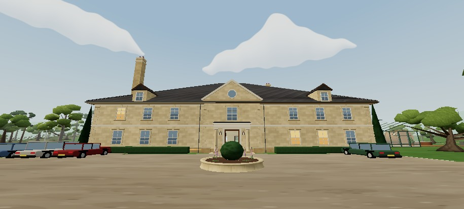

# SKY-C01 — approved A activation

Owner selected **A** and requested implementation on 14 October 2026. The previously reviewed procedural A is now the default sky shader in **ordinary estate gameplay**, on both Low and High, without URL/review flags. The eight shapes, placement, scale, warp and cloud shading are unchanged from the owner-reviewed version. B and the previous ENV-L01 clouds remain available only as sandbox comparisons; no B texture is loaded by ordinary gameplay.

## Scope and baseline

Dedicated branch remains `sky-c01-organic-clouds`. Starting SKY checkpoint `39cc57ad2ec2050bfba16857470eaf927436e663` and all original comparison evidence are retained. Integrated current published production `5ca306da6a32f33b4c93c90ace3556e2787c67d4`: TUT-R01 plus PB01. Neither update overlaps SKY source. TUT home changes are included exactly as published. PB01 changes the provisional documented ceiling/test guards, with no runtime vegetation change beyond a comment. Unmerged GEO/VEG work is not incorporated. No other worktree or feature branch modified.

This request authorizes selecting and implementing A. **Production merge and Pages deployment have not been performed or inferred from “implementeren”.** A is release-ready source on the feature branch; a subsequent live instruction can authorize publication.

## Change

- `env.ts`: initialize the existing dome with A and retain A in normal gameplay regardless of review-only overrides. Clouds-off remains cosmetic; approved phase palettes, fog, exposure, puzzle progress and save behavior remain intact.
- `lightingReview.ts`: default the review selector to A; label the old ENV cloud option as previous clouds. Normal UI is unchanged.
- `tests/sky-c01.test.ts`: assert A from the first normal-world construction and verify normal candidate overrides cannot load B or change the selected shader.
- `scripts/sky-c01-qa.mjs`: assert active A in ordinary gameplay, prove normal A equals reviewed A pixel-for-pixel at a matched sky camera, and capture normal daylight/High portrait dusk.
- Updated status/report supersede the initial B recommendation. A's authoring/render source, `skyShader.ts` historical comparison and `lightingPhases.ts` are unchanged.

## Validation

Typecheck and build pass. **278/278 unit tests**, **18/18 SKY browser checks**, **12/12 selected existing walkthrough/save checks**, **4/4 current PB01 budget checks** pass. Full route: tutorial → finale, 70 steps / 31 clues; save reload, migration and restoration remain correct. No shader/GL errors recorded in phase/quality checks. Tests cover eight ordinary phase/location combinations, normal A ignoring sandbox overrides, cloud-off light/flag parity, actual review save isolation, deterministic A/B review reload and High portrait rendering.

The normal A sky framebuffer hash exactly matches the sandbox A framebuffer hash at the same camera, phase and quality. [Browser results](activation/review-qa.json), [gameplay/save results](activation/gameplay-qa.json), [unit log](activation/unit-tests.txt), [source and build fingerprints](activation/provenance.json), [High portrait dusk](activation/normal-a-dusk-portrait.jpg).

Build gzip JS 430.26 kB. Tested bundle BUILD marker is `39cc57a` because the activation was built from the working tree before committing. Recorded source-file SHA256 fingerprints bind the actual active code; final Git tree/branch history binds those files. The final rebuild after the published PB01 update is byte-identical to the rendered/tested bundle, so no runtime change is hidden by that integration.

No new cloud draws, triangles or runtime texture allocation. The prior A software timing observations remain applicable to the unchanged A shader; they are not physical Samsung GPU/FPS measurements. Actual Android pacing and thermals remain unverified. No extra visual refinement or silent quality reduction applied.

## Reproduce and next action

Use the existing commands in REPORT.md for typecheck, build, units, SKY QA and selected gameplay/save suites; add `npm run test:budget` for the integrated PB01 guards. SKY QA requires explicit output directory and compatible `headless_shell`. Ordinary local preview `/Feh-Lu-We/` now uses A automatically; sandbox comparisons remain at `?review=lighting&sky=production|procedural|masks`.

Next authorized publication would merge only this reconciled SKY branch via the repository's normal process, verify CI/Pages and served bundle, and let the owner inspect warmed performance on Samsung. This handover does not claim the new clouds are live.
