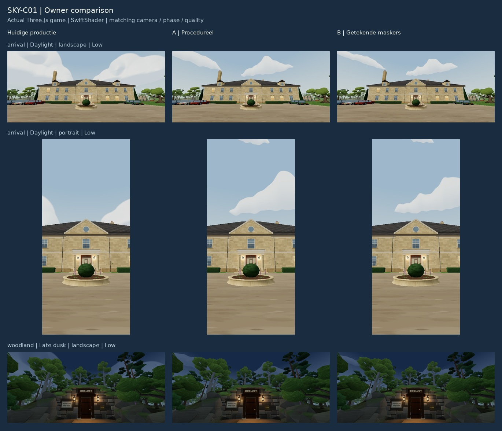
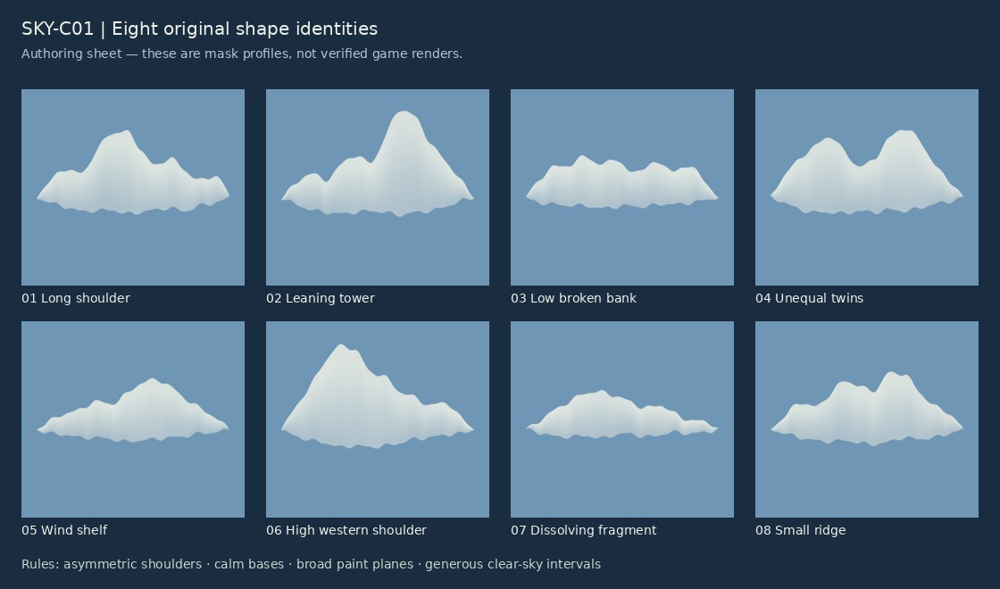

# SKY-C01 — owner review, recommendation and implementation handover

**Status: READY FOR OWNER REVIEW. No merge, deployment or final selection.**



## Decision

Recommend **B, authored masks with the existing phase-driven shader**, as the continuation basis. Both candidates materially improve silhouette variety and remove the production shader's circular depressions. The visible A/B difference is modest; B is preferred for precise outline editing and its lower measured software fragment cost, not because the screenshots establish a decisive artistic victory.

The principal trade-off is calmer, flatter cloud massing versus the current exaggerated puffiness. B still has some pointed, mountain-like crowns and uniform base rhythm. If the owner wants more sculptural cumulus, the smallest next iteration is to broaden/round the upper shoulders of identities 02 and 06 and strengthen one broad underside plane in those masks. Keep placement, palettes and overall coverage fixed. Do not combine A's contour evaluations with B unless a further comparison demonstrates a visible benefit; that hybrid would currently spend complexity without evidence.

**Owner decisions:** choose A, B, or that narrowly specified B refinement; judge whether the reduced scale and softer volume suit the manor. Any eventual integration/merge/deploy is a separate explicit authorization. Physical Samsung testing remains a gate for claiming mobile pacing/thermal suitability.

## Verified baseline and scope

Default branch `ccr-75ef4113-kfkimm`, production baseline `fe74db0b471d7816d840e6c223b92950adf5639f`. Live HTML served `index-D3-sdVd1.js`; its contents identify `fe74db0 · 2026-10-14`, SHA256 `907a42e31c08146cc19ef8f5881f4a951f50738931438b37ffc54597c4faea44`. ENV-L01 is already integrated and active in normal gameplay; historical branch notes saying otherwise were not used as deployment evidence. UI-R02 is also in this baseline.

Inspected `skyShader.ts`, `env.ts`, `lightingPhases.ts`, ART-01's `docs/art-refresh/STYLE_TARGET.md`, relevant art-bible principles, the ENV visual direction/review/implementation/release reports and sky QA harness. The actual production shader has three directional groups, each with the same seven polynomial lobes and field-gradient normals. Owner images `82160.jpg` and `82162.jpg` were visually inspected: both show a similar central circular depression and very large puff outline despite different surroundings. Those phone images are observations, not controlled GPU benchmarks or exact matched-camera reproductions.

Separate local GEO-R01/TUT-R01/PB01 worktrees were inspected and left untouched. SKY's new source does not import their changes. PB01's remote proposal records 750k submitted camera triangles as a provisional development budget, not a device-validated ceiling; it was outside the captured baseline. The historical 250k guide was not used as a cloud constraint. High daylight legitimately submits 362,317 triangles in the measured arrival view.

## Compact visual direction



These references were visually inspected for principles, without tracing or redistributing their pixels:

| Reference | Borrow | Reject / limit |
|---|---|---|
| [Sea of Thieves, Smugglers' Bay screenshot](https://www.shacknews.com/article/105662/where-to-find-all-skeleton-thrones-in-sea-of-thieves) ([image](https://d1lss44hh2trtw.cloudfront.net/assets/editorial/2018/06/Sea-of-Thieves-Skeleton-Thrones-Smugglers-Bay.jpg)) | Unified mass with broad light/shadow regions; irregular protrusions with an identifiable parent mass | Hero-cloud scale, tropical saturation and dark undercuts. Rare's [Creating Clouds article](https://www.seaofthieves.com/news/archive/short-haul-3) was searchable but direct retrieval returned 403; it is not implementation evidence |
| [OMNO official presskit](https://www.playomno.com/presskit), ScreenShot00024 / ScreenShot00035 | Few broad, softened shapes; clear sky intervals; restrained detail at landscape scale | Sea-of-clouds coverage and floating-landscape theme. No rendering technique inferred |
| [Met Office cumulus photograph and low-cloud descriptions](https://weather.metoffice.gov.uk/learn-about/weather/types-of-weather/clouds/low-level-clouds) | Unequal shoulders and widths, flatter underside, bright tops/cooler bases, multiple growth scales | Photographic noise, harsh meteorological realism, storm development |
| [Panorama Mesdag media kit: Schelfhout, boats and fishermen near Scheveningen](https://panorama-mesdag.nl/en/press/media-kits/media-kit-light-air-water-/) ([painting](https://panorama-mesdag.nl/documents/321/Andreas_Schelfhout_Boten_met_vissers_op_het_strand_bij_Scheveningen_ca._1828.jpg)) | Broad merged value masses, sky openings and distant atmospheric softening | Dominant storm-like coverage, grey drama and literal painting texture |

Rules and review criteria:

- **Silhouette:** one coherent mass with unequal main shoulders, subordinate protrusions and a partly flattened, irregular base. Tiny edge waves must not become an evenly spaced scallop pattern. Distinguish a low bank, leaning tower, broken bank, unequal twins, wind shelf, western shoulder, dissolving fragment and small ridge.
- **Surface:** broad upper light / underside shade; bounded tonal variation rather than per-lobe normal gradients. Reject closed circular shade rings or repeated crater-like centres. Current candidates satisfy that negative criterion but intentionally have restrained perceived depth.
- **Composition:** eight unique identities, each used once, with fixed different widths/heights/aspects and slight rotations. Do not fill every interval; preserve mostly open zenith and foreground landmark prominence. Some broad clouds still clip in narrow portrait views; reduced size does not guarantee every cloud fits on screen.
- **Atmosphere:** keep existing horizon fade, four phase palettes, opacity progression, sun direction and ACES/exposure. Colour should transition continuously without new world light or haze changes.
- **Testable contracts:** exact candidate parity for camera/light/haze/geometry at matched settings; zero shader/GL errors; identical cloud-off sky pixels; deterministic reload pixels; no azimuth seam or visible atlas cell boundary in the captured views; no persistent save or puzzle completion effects.

## Prototypes and comparison

**A:** eight unequal analytic shoulder profiles, two small bounded contour-warp scales, nonuniform base functions, broad height/paint-plane shading. No texture. Early directional/local bounds skip off-cloud work. No noise octaves, animation, field-normal relief or raymarching.

**B:** eight separately authored top/base outlines, interpolated and antialiased into one 1024×512 RGB atlas. R is silhouette coverage; G is relative vertical thickness/height for shading, not physical optical density; B supplies broad paint-plane variation. One atlas fetch per intersecting candidate. Linear-data texture, mipmapped/trilinear minification, linear magnification, tile gutters and local UV clamping. Gutters prevent visible cross-cell contamination at tested game scales; extreme subpixel atlas minification is not exhaustively tested. No photo/imagegen source is bundled.

Both use the same fixed spherical tangent-frame placement, aspect/rotation and compositing. There is no azimuth UV wrap, time seed, view-dependent reshuffle or repeated tiled shape. Shared shaded cloud colours are still the approved phase inputs. The shader's background, sun disc/glow, tone mapping and output suffix are byte-identical to production; `lightingPhases.ts` is unchanged.

| Criterion | Current production | A | B |
|---|---|---|---|
| Silhouette / organic variation | Repeated rounded seven-lobe construction | Eight unequal profiles; smooth analytic shoulders | Eight editable drawn profiles; more specific edge rhythm |
| Volume / circular artifacts | Visible crater-like relief | Circular relief removed; deliberately flatter | Circular relief removed; broad planes, still flatter than sculptural reference |
| Group distinction / turns | Essentially one family in three sizes | Clear bank/tower/fragment differences | Similar distinction, more direct art control |
| Negative space / scale | Large clouds dominate some views | Calmer; no dominant cloud at every heading | Calmer; occasional pointed/cropped crowns remain |
| Colour / phase integration | Approved baseline | Preserved numeric lighting and palette | Preserved numeric lighting and palette |
| Overall art fit (judgment) | Too primitive and repetitive | Meaningful improvement, limited fine control | Preferred basis; requires owner judgment on flatter massing |

### Evidence index

Each image has production / A / B columns; every full-frame capture is scaled without cropping, paintovers or synthetic imagery. UI overlays are excluded because captures come directly from the real game canvas.

| View | Landscape, all four phases | Portrait, all four phases |
|---|---|---|
| Mostly open sky | [Sky](evidence/sky-landscape.jpg) | [Sky](evidence/sky-portrait.jpg) |
| Manor/garden | [Garden](evidence/garden-landscape.jpg) | [Garden](evidence/garden-portrait.jpg) |
| Arrival court / manor | [Arrival](evidence/arrival-landscape.jpg) | [Arrival](evidence/arrival-portrait.jpg) |
| BOSLUST woodland opening | [Woodland](evidence/woodland-landscape.jpg) | [Woodland](evidence/woodland-portrait.jpg) |

[Four headings](evidence/turns.jpg), [359.9° / 0.1° seam vicinity](evidence/seam.jpg), [Low/High daylight and late dusk](evidence/quality.jpg). The phase-dependent sky joins preserve the original haze pipeline. Shader mathematics is continuous in direction; the still seam views are not a physical-device pan/aliasing test.

120 valid captures: 96 main matrix + 6 High + 18 turn/seam. The first turn pass accidentally reused filenames; those overwritten frames were excluded and only that 18-frame subset was recaptured under unique names. Measurements retain the original matrix/timing run and corrected turns separately. Only twelve useful sheets are committed, rather than 120 raw JPEGs. [Manifest](evidence/sheet-manifest.json) maps raw file hashes to durable sheet rectangles; raw captures are reproducible with the harness.

## Performance and QA

Actual Three.js/WebGL2 with ANGLE SwiftShader, headless Chromium 141.0.7390.37; touch/mobile viewport 915×412 or 412×915, browser DPR1. Low renderer cap1; High cap1.5. Fixed scene, cameras, doors, phase and room blend, settled LOD. Full Chromium's startup was blocked by AF_UNIX restrictions; the single targeted alternative, `headless_shell`, succeeded. Canvas render-and-encode avoids compositor screenshot timing dependence.

Timings below are **synchronized software render wall times, not Android GPU times, FPS, rAF pacing or thermals**. Daylight arrival, Low/landscape. Three rotated variant orders; five warmup renders and seven samples per round, 21 samples per cell. Shader/texture compilation was warmed separately.

| Scope / median ms | Production | A | B |
|---|---:|---:|---:|
| Entire scene | 111.3 | 129.5 | 113.1 |
| Isolated sky, same dome/camera | 12.4 | 32.8 | 13.7 |

A's software sky median is about 2.65× baseline; B about 1.10×. **B pacing parity is not established:** sky samples ranged 11.5–80.0 ms, with a nearest-rank p95 of 31.5 ms versus baseline 14.2 ms. Shared-host scheduling and SwiftShader execution are uncontrolled factors. Medians suggest an implementation-cost preference, not a mobile release qualification. [Raw measurements](evidence/measurements.json), [summary](evidence/performance-summary.json).

- **Geometry:** zero additional draws/triangles for either candidate. Arrival Low: 128 calls / 211,858 triangles; High daylight: 160 / 362,317; High dusk: 128 / 211,858. All matched variants agree exactly within each view/phase/quality. Across supplemental sessions, settled vegetation counters may differ slightly; no cross-session equality is claimed.
- **Textures:** A adds none. B owns one lazily loaded texture; estimated RGBA8 storage 2 MiB base / approximately 2.67 MiB with mipmaps. PNG transfer 198,404 bytes. This is an allocation estimate, not measured physical GPU residency. After first B selection, the review retains its texture for later switches until world disposal. Normal gameplay makes no atlas request and allocates no atlas.
- **Build:** typecheck and production build pass. 24 unit files, **278/278** tests pass, including three SKY isolation/palette/suffix contracts and existing ENV continuity/sunset/woodland tests. Review bundle gzip 428.98 kB; no dependency/lockfile change. Vite's existing chunk-size warning remains.
- **Visual/render:** 120 valid captures, no recorded GL/shader/page errors; matched numeric global-light/fog/exposure/geometry parity. Cloud-off framebuffer equality across all three candidates.
- **Review QA:** **17/17** checks pass: actual UI selector and on/off, 122 continuous phase render samples, deterministic A/B reload pixels, actual sandbox save preserving normal save/backup, no completion flags from review controls, ordinary home/estate mode ignoring candidate overrides, eight normal phase samples, cosmetic toggle parity and High portrait compilation. [Results](evidence/review-qa.json).
- **Gameplay/save:** existing selected suites **12/12**, full tutorial → finale (70 steps, 31 clues) and save/migration/restore checks; no console errors/404s. [Results](evidence/gameplay-qa.json). Other UI/vegetation/collision suites were not repeated for this cloud-only change.
- **Harness qualifications:** inherited ENV smoke passed eight normal phase renders then asserted portrait aspect before resize settled. SKY's dedicated test waits for the actual resize and passes. Its first estate-seeding attempt also raced pagehide saving from the still-running home game; the harness now pauses the disposable game before seeding. These are corrected test setup issues; gameplay code was not changed. No broad regression investigation performed.

Unverified: physical Samsung/Chrome GPU cost, 10-minute warmed frame pacing, thermals, native display DPR/color and first-selection texture loading under weak connectivity. B's first switch can briefly show clear sky while the atlas loads; if chosen for production, preload/ready handling should be decided during integration. No weather, shadows, volumetric parallax or lighting redesign is proposed.

## Implementation handover

Dedicated branch: **`sky-c01-organic-clouds`**. Render source: local `3934f95`, remote content-equivalent checkpoint **`331ac62190405a6b5dd8ec6d813b150c2eca2cee`**, identical Git tree `e6ceaf489aab1190113074414fb3f58115625dc9`. Build JS/atlas SHA256 values are in the measurement files. The rendered bundle's BUILD marker remains `3934f95`; the final report/capture-harness commit does not alter the rendered cloud implementation. Shell push lacked credentials; authenticated GitHub commits preserve the same tree and safe branch ancestry. The original local commit is retained on `sky-c01-local-provenance`; no reset/force-push was used.

Changed implementation: `src/world/cloudPrototypes.ts` (new), `src/world/env.ts` (review-only shader/atlas selection), `src/ui/lightingReview.ts` (review-only selector), `src/assets/sky-c01-cloud-atlas.png` (new). Production `src/world/skyShader.ts` and phase palette are unchanged. Additional files: `tests/sky-c01.test.ts`; `scripts/sky-c01-{capture,qa}.mjs`, `scripts/sky-c01-{masks,sheets}.py`; this consolidated report, direction sheet, evidence and the SKY workstream record. No UI flow, puzzle, world mesh, save schema, game loop or dependencies changed.

Reproduce from this branch with matching lockfile dependencies:

```sh
npm ci
npm run typecheck
npm test
npm run build
CHROME=/path/to/compatible/headless_shell node scripts/sky-c01-capture.mjs /absolute/raw-captures
CHROME=/path/to/compatible/headless_shell node scripts/sky-c01-qa.mjs /absolute/qa-output
CHROME=/path/to/compatible/headless_shell E2E_ONLY=walkthrough,saveChecks E2E_OUT=/absolute/gameplay-output node scripts/with-preview.mjs e2e.mjs
python3 scripts/sky-c01-sheets.py /absolute/raw-captures /absolute/sheets
```

For asset regeneration, `python3 scripts/sky-c01-masks.py` requires Pillow/numpy/scipy; sheet generation requires Pillow/DejaVu fonts. These are authoring tools, not new runtime dependencies. Capture needs an explicit writable output directory and starts its own preview server; do not rebuild dist during captures. Open a local preview at `/Feh-Lu-We/?review=lighting&sky=masks` or `sky=procedural`, expand ENV-L01, compare phases/locations/quality and the SKY selector. `sky=production` is the current cloud baseline, **not** the ENV review's legacy `system=baseline` lighting option.

Next safe action: owner reviews the sheets and selects direction/refinement. If integration is later authorized, reconcile `env.ts` and `lightingReview.ts` with the then-current ENV branch, remove review-only unused candidate code if appropriate, validate the chosen implementation on Samsung and perform the existing release process. Exit review to return to the unchanged normal-game cloud baseline on this branch.
