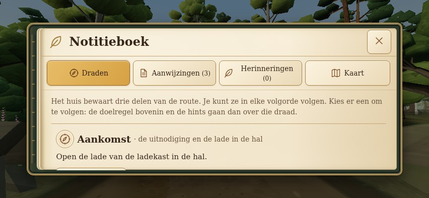

# UI-R02 — Woodland Archive visual review

The current revision implements the owner's notebook reference: a smaller bound notebook over the game, green cover edge, warm paper, horizontal tabs, copper notebook icons and gold HUD icons. Real content, counts, observations, selected items and navigation are preserved.

**These are actual browser screenshots of the running Three.js game.** No generated scene or concept image is used as implementation evidence.

| Current evidence | What to review |
| --- | --- |
| [Desktop notebook](evidence/book/desktop-boslust-notebook-threads.jpg) | Bounded book, visible environment, copper thread marks and gold active tab |
| [Smaller landscape notebook](evidence/book/small-boslust-notebook-threads.jpg) | 640 × 360, wrapping tabs and independently scrolling page |
| [Recorded evidence](evidence/book/phone-boslust-notebook-evidence.jpg) | Real clues, readable symbols and text |
| [Contextual interaction](evidence/book/phone-context-action.jpg) | Explicit action and gold action icon |
| [Selection and short feedback](evidence/book/phone-held-feedback.jpg) | One selected item, original item picture and real message |
| [Notebook map](evidence/book/phone-notebook-map.jpg) | Existing discovery-filtered map and back route |
| [Dark BOSLUST](evidence/book/phone-boslust-dark.jpg) / [bright garden](evidence/book/phone-garden-bright.jpg) | Gold chrome against the actual environment |
| [Portrait fallback](evidence/book/portrait-boslust-notebook-threads.jpg) | Map on a second navigation row; page scrolling |

[Current revision QA and reproduction](UI-R02_BOOK_REVISION.md) · [Architecture and design system](UI-R02_AUDIT_AND_DESIGN.md) · [Current UI results](evidence/book/ui-results.json) · [Capture provenance](evidence/book/captures.json)

The actual production Draden content includes arrival and next-step guidance. This appearance change preserves that logic; it does not invent completed threads or copy the reference's example counts. Aanwijzingen and Herinneringen remain based on recorded observations. Illustrated item icons and puzzle symbols retain their original colors.

The initial editorial version and its full-game validation remain available in the [historical QA report](UI-R02_QA_REPORT.md) and [production/first-pilot comparison](evidence/before-after.jpg).

Owner visual approval remains the next gate. Inventory, pause/settings and puzzle interface expansion are deferred. Physical Android/iPhone font appearance, contrast and thumb comfort still need review. Draft PR only; no merge or production deployment.
