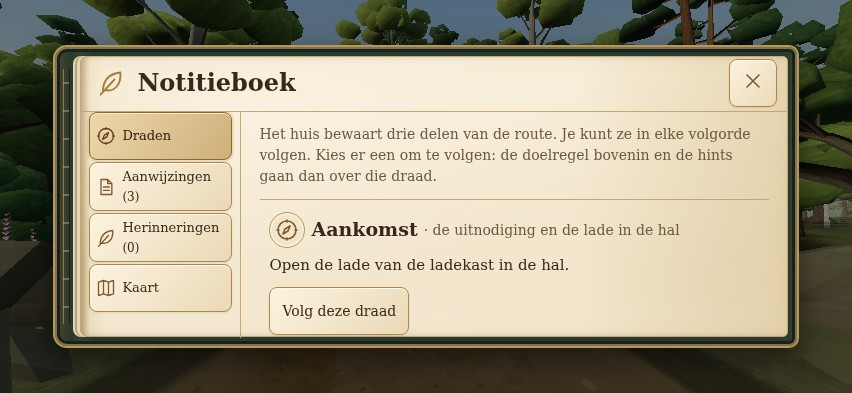
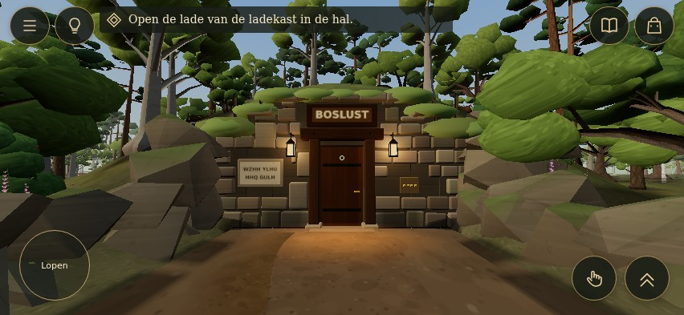

# UI-R02 — Woodland Archive visual review

Current mobile landscape categories sit to the left of the notebook page. Portrait opens a category index, then a reading pane with a persistent category-back button. Exploration uses beige-gold round controls, a marked objective beside Hint, and bottom-right sprint/item controls.

**All images are actual browser screenshots of the running game.**

| Current evidence | Review |
| --- | --- |
| [Portrait categories](evidence/mobile/portrait-notebook-categories.jpg) / [reading pane](evidence/mobile/portrait-boslust-notebook-threads.jpg) | Category choice, hidden index and back |
| [Portrait evidence](evidence/mobile/portrait-boslust-notebook-evidence.jpg) / [rotated session](evidence/mobile/portrait-rotated-evidence.jpg) | Readability, scrolling and rotation |
| [Selected item / feedback](evidence/mobile/phone-held-feedback.jpg) | Original item picture in the persistent control |
| [Sprint state](evidence/mobile/phone-sprint-equipped-controls.jpg) | Visible pressed state; existing speed, no autonomous movement |
| [Smaller landscape](evidence/mobile/small-boslust-notebook-threads.jpg) | 640 × 360 side index |
| [Desktop](evidence/mobile/desktop-boslust-notebook-threads.jpg) | Retained top tabs and keyboard navigation |
| [Recorded evidence](evidence/mobile/phone-boslust-notebook-evidence.jpg) | Real clue text and diagrams |
| [Contextual action](evidence/mobile/phone-context-action.jpg) / [map](evidence/mobile/phone-notebook-map.jpg) | Original actions, discovery filters and back route |
| [Dark BOSLUST](evidence/mobile/phone-boslust-dark.jpg) / [bright garden](evidence/mobile/phone-garden-bright.jpg) | Contrast over the actual world |

[Current QA and recovery report](UI-R02_MOBILE_REVISION.md) · [Architecture / design system](UI-R02_AUDIT_AND_DESIGN.md) · [UI checks](evidence/mobile/ui-results.json) · [Capture provenance](evidence/mobile/captures.json)

The empty item control opens the original inventory; selected items retain tap-to-deselect. Sprint resets on overlays, blur, hide and resize. Shift and analogue running remain. Real notebook records, counts and completion state are preserved.

[Historical top-tab book](UI-R02_BOOK_REVISION.md) · [Historical first pilot](UI-R02_QA_REPORT.md)

Draft for visual review. Production is unchanged. Physical-device review remains pending; inventory, pause/settings and puzzle-interface expansion waits for approval.
