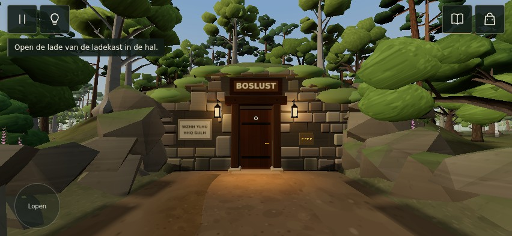
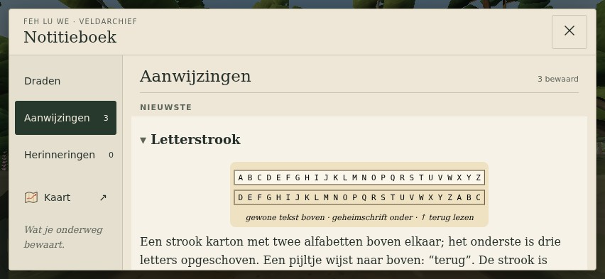

# UI-R02 — Woodland Archive visual review

This draft implements the normal-game exploration HUD and notebook on the verified production baseline. It is ready for a bounded visual review; final direction approval is still required. Inventory, pause/settings and puzzle interface expansion is deferred.

**All images below come from the running Three.js game.** Caption sheets arrange actual captures at native size. No generated environment or concept image is used as implementation evidence.

Start with the [production/pilot comparison](evidence/before-after.jpg), then examine the two primary phone captures at their actual 852 × 393 viewport:

| Evidence | What to inspect |
| --- | --- |
| [Before / after](evidence/before-after.jpg) | Same BOSLUST pose and viewport; same recorded clue set; quiet HUD and editorial notebook |
| [Mobile interaction states](evidence/mobile-states.jpg) | Real contextual action, selected item/feedback, map and observed memory |
| [Smaller landscape](evidence/small-landscape.jpg) | 640 × 360 exploration/notebook/action; tutorial message and packing checklist |
| [Desktop](evidence/desktop.jpg) | 1440 × 900; labeled chrome and bounded notebook width |
| [Bright / dark backgrounds](evidence/contrast.jpg) | Production garden and BOSLUST dusk fixture; lighting code unchanged |
| [Portrait fallback](evidence/portrait.jpg) | 393 × 852; top index and scrollable evidence |

[Audit, source limitations and design system](UI-R02_AUDIT_AND_DESIGN.md) · [QA report and reproduction](UI-R02_QA_REPORT.md) · [All UI checks](evidence/ui-results.json) · [Capture provenance](evidence/captures.json) · [Sheet/source mapping](evidence/sheets.json)

## What is preserved

Draden, Aanwijzingen, Herinneringen and the existing Kaart route retain their real content and state filters. Progression and optional hints stay available. Illustrated item icons, item selection, puzzle symbols, interactions, save behavior, touch gestures and keyboard commands use their existing game paths. One overlay blocks world input and obscured HUD controls; action feedback stays accessible.

The production Draden panel still contains its pre-existing next-step guidance. This appearance pilot does not silently rewrite it into the DEV-01 research model or add new quest-log logic.

## Visual decision required

Judge the HUD's quietness, the notebook hierarchy/material restraint and mobile readability. Does this feel sufficiently like W2 / Woodland Archive, and are the notebook size and icon treatment appropriate for Feh Lu We?

The five newly supplied images were unavailable. The earlier recovered W2 library-scene references informed this pilot; the later BOSLUST concepts and the owner's original HUD-free scene still require direct comparison. Re-upload those references before claiming fidelity to that final concept set.

Physical Android/iPhone checks remain necessary for font appearance, display contrast and thumb comfort. Emulated browser captures are not physical-phone performance evidence. No merge or production deployment is part of this review.
