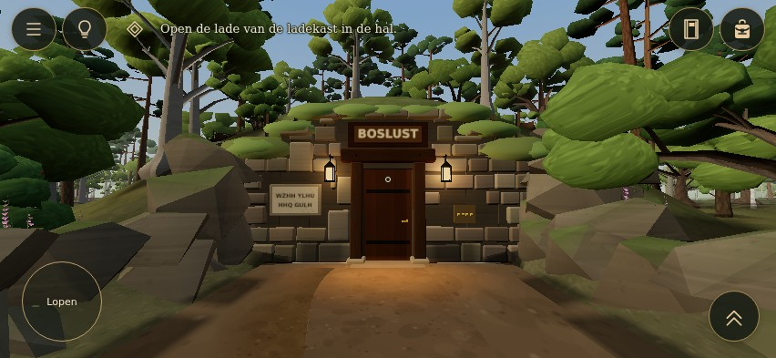
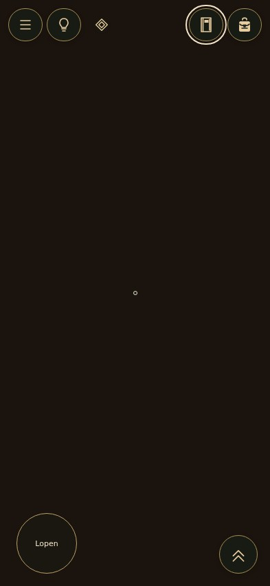
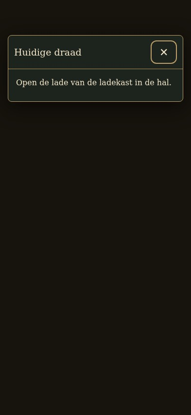

# UI-R02 — mobile playtest feedback, 14 October 2026

Base: production `6b2b82d95fc761390b9275c94ee363f37a25f6bf`, verified before editing. Branch: `ui-r02-mobile-feedback`. PR #16 was already merged; this is a separate, bounded follow-up. ENV-L01 #15 and VCP-01 #9 remain separate. No world, input, movement, puzzle, item-state or save file is changed.

## Evidence and findings

The supplied `82104.png` and both original videos (`82102.mp4`, 76.28s; `82103.mp4`, 34.16s) were read from their uploaded local copies. No generated image is used as evidence. The recordings show the opaque objective strip, a narrow text column after rotation, the empty hand duplicating the bag shortcut, and inventory actions falling below the scrolled item grid.

The sprint indicator toggles in the video. The existing joystick already ramps into jogging over its outer fifth: `Input.sample` sets run amount to 1 at full throw, with or without the shortcut. `PLAYER.walk` is 3.2 and `PLAYER.run` is 5.0. Consequently, toggling the shortcut at full throw cannot make movement faster. Earlier shortcut tests covered partial throw and pressed state, which did not prove a speed difference at full throw. This is an unresolved control-design conflict, not evidence that the event handler never executes.

Inventory currently exposes “In de hand nemen” for every owned item. Register/journal already have a “Lezen” action through `readClue`, but it is easy to miss below the scrolling grid. Keys auto-unlock their matching doors without being selected. The torch's light state is independent of selected item; it can illuminate while matches are held.

## Implemented HUD corrections

- Landscape/desktop objective uses 13px serif text, a small diamond and text edge/shadow separation, without an opaque background.
- Portrait shows only the 48px objective marker. Activating it opens a bounded 16px reading panel through the existing single-overlay/input/focus management; Escape/outside dismissal returns focus. No new objective information is generated.
- Portrait packing requirements move into that same panel, so the five original requirements remain accessible without a thin HUD column.
- A closed notebook and filled backpack replace the generic open-book/shopping-bag chrome. Existing item pictures remain.
- Empty hands have no duplicate inventory button. The selected-item control remains visible when equipped; its existing deselect behavior is unchanged until an item-action design is approved.
- Portrait feedback uses the available screen width and stays above bottom controls/contextual action. Background toast visuals no longer cover focused reading panels.

## Inventory proposal — not implemented

Organize by meaningful player action, using per-item capabilities instead of a universal equip button:

| Section | Existing items | Offered actions |
| --- | --- | --- |
| Gereedschap | Zaklamp, lucifers, aanmaakhout | Equip when meaningful; local toggle for light or use/place on a world target |
| Documenten en vondsten | Uitnodiging, landgoedregister, boswandeljournaal, letterstrook | Read/inspect; no equip; preserve actual diagram and text |
| Sleutels en zegels | Four keys, three seals | Describe/inspect; keys auto-unlock; seal placement stays in the existing puzzle panel |
| Notitieboek | The owned notebook | Open the existing archive; no equip |

Only owned items are listed. No undiscovered slots, recipes, future doors, relationships or solution labels. Document capability and puzzle use can coexist, e.g. the letter strip. Keep the selected interaction item distinct from the item whose details are being inspected. Keep item actions visible in a fixed detail area; portrait should use item list → detail → back rather than placing actions beneath an entire grid. A reading view should return to the same inventory detail, preserving selection and scroll.

The bag stays the sole inventory entry. Bottom-right item controls should operate the actual equipped function, not open another inventory: torch power when present, and a clear held-item status for world tools. Equip/store belongs in the bag. No hidden long-press or new cycling gesture is needed for the small tool set.

A strict “torch only illuminates while the one selected item is torch” would extinguish it when selecting matches in a dark room. Recommended: retain an independent carried-light state/shortcut while allowing one selected puzzle tool. If the owner prefers strictly one handheld object, choose that trade-off explicitly before implementation. No 3D hand/torch model is included.

## Movement proposal — not implemented

Use one explicit mobile jog toggle and desktop Shift; remove automatic full-stick jogging. Start testing with walk 3.2 and jog 4.2 (about 31% faster), not the current 5.0. Full-stick default movement would already slow from the current automatic 5.0 to 3.2, so lowering the base walk speed additionally is unnecessary initially. No stamina, sprint tiers or cooldown. Reset remains on modal, blur, hide and rotation. Review outdoors and in narrow rooms before selecting final values.

## Basis and review gates

The grouping/action proposal is game-specific design judgment. Microsoft XAG 114 supports making action purpose clear before activation; XAG 112 supports predictable navigation/focus and consistent placement. XAG 102 requires readable contrast; bare HUD text over moving backgrounds cannot carry an unconditional token-only contrast claim, so the opaque on-demand reading panel remains an alternative.

- https://learn.microsoft.com/en-us/xbox/accessibility/xbox-accessibility-guidelines/114
- https://learn.microsoft.com/en-us/xbox/accessibility/xbox-accessibility-guidelines/112
- https://learn.microsoft.com/en-us/xbox/accessibility/xbox-accessibility-guidelines/102

FLW-PDI-01 was read from its existing project source. The copy is marked proposed/draft, not automatically active; task-specific approval and isolation rules remain authoritative.

Validation: TypeScript, build and **267 unit tests passed**. The focused HUD/navigation suite passed **44/44 checks** across 852 × 393, 640 × 360, 393 × 852 touch and 1440 × 900 desktop. Native pointer actions, focus/escape, target sizes, overflow, records, item selection and memory-tab activation were checked. It loads the real game, then stops the animation loop and renders the actual world once per viewport to limit redundant software-GPU work. This is UI validation, not a new gameplay walkthrough or speed benchmark. The packing probe supplies five real labels with fixture status bits only to the UI; it does not alter game progression and is excluded from the delivered gallery.

The wider normal-render UI attempt passed **105/107** executed checks; desktop and portrait memory-tab operations timed out. The exact cause is unproven. The same native memory-tab actions pass when background rendering is stopped, suggesting a timing/resource factor rather than demonstrating a production regression. Full normal-render regression completion and physical-device review remain open. No assertions or timeout criteria were weakened. Earlier overlapping runner output was discarded; the reported runs use separate directories.

Standard Chromium initially failed before opening a page on the sandbox's forbidden process-singleton socket; the prior successful headless shell was restored. A marker hit-test failure was fixed by explicitly enabling pointer events inside the otherwise passive HUD cue.

Reproduce focused checks: `E2E_OUT=scripts/out/ui-r02-feedback-focused node scripts/with-preview.mjs e2e-ui-r02-feedback.mjs`. The broad UI script retains all four profiles and the updated empty-hand contract. Runtime/test/bundle hashes and fixture limits are in [provenance](evidence/feedback/build-provenance.json); [focused results](evidence/feedback/focused-results.json), [wider attempt](evidence/feedback/broader-attempt-results.json) and [sprint diagnosis](evidence/feedback/diagnostics.json) are preserved.

## Actual browser review images

[Smaller landscape](evidence/feedback/small-exploration.jpg) · [Desktop](evidence/feedback/desktop-exploration.jpg) · [Dark BOSLUST](evidence/feedback/phone-boslust-dark.jpg) · [Bright garden](evidence/feedback/phone-garden-bright.jpg). All seven JPGs are unedited browser captures of the actual WebGL world and DOM interface. The first five use the focused rendering fixture; the contrast pair uses the normal-render wider run.

Inventory and speed changes await a design decision. This follow-up remains draft for visual review; no merge or deployment is included.
