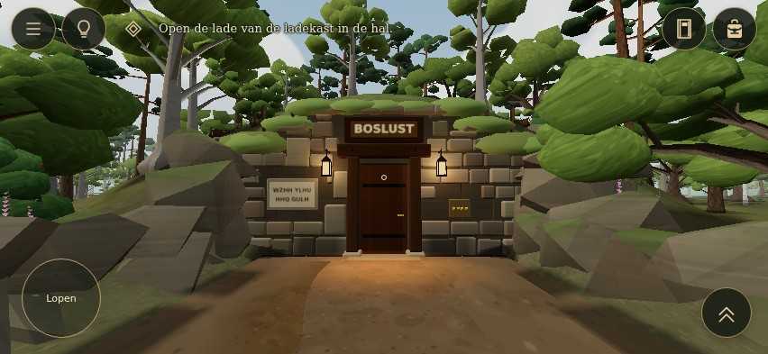

# UI-R02 — mobile playtest feedback, 14 October 2026

## Recovery completion — current review checkpoint, 14 October

**HUD complete; owner review pending. No additional runtime redesign was needed.** The four existing feedback commits were recovered intact from `cf932d7`. Their three UI runtime hashes and two test-script hashes match the historical provenance exactly. The isolated recovery checkout had no pre-existing local edits, local-only commits or leftover browser processes. No work from another checkout or branch was modified. FLW-PDI-01 v0.1 was read from the supplied project source and applied under this task's explicit instructions.

Production `5a6c37a` (ENV-L01) is now a parent of the existing feature branch through integration commit `aa71411ac30a25aa926e024c0a77207b4c67151c`. Integration was conflict-free. UI runtime files remain byte-for-byte identical to `cf932d7`; environment, game-loop and startup files remain identical to production. No VFC/DEV experimental branch was imported. The CLI lacked push credentials; the authenticated GitHub connector published the identical integration tree with both original parents, without a forced ref update. The local build commit has different metadata but the same tree; see provenance. PR #17 stays draft. Production was not changed.

### Original feedback reconciled

The supplied local PNG and both original MP4 files were inspected again through extracted frames spanning the full recordings, with original durations 76.276s and 34.158s. Attachment hashes are preserved in the new provenance. The PNG is the intended visual reference. In video 1, roughly 32–44s shows inventory scrolling and **Lezen** below the item grid: reading already exists for some documents but is poorly discoverable. Roughly 52–72s shows torch lighting, followed by a selected matches icon with the light still on. Video 2 shows the running indicator on at roughly 6–12s with the stick extended, then the portrait objective column after roughly 18s and the long inventory at roughly 30s. Video alone cannot establish movement speed; source and the preserved input diagnostic establish the full-stick auto-run conflict.

| Owner complaint | Verified status |
| --- | --- |
| Dominant landscape objective / opaque strip | Resolved by existing 13px unbacked serif text and small marker; visually reviewed against bright sky and late-dusk woodland. |
| Portrait text column | Resolved by marker-only exploration and bounded on-demand reading panel; five packing requirements retained. |
| Unclear notebook/backpack icons | Existing revised icons preserved, including warm chrome and coloured item pictures. |
| Duplicate empty-hand inventory button | Hidden when nothing is selected; actual selected item remains visible and deselects as before. |
| Feedback covering reading | Existing suppression verified with a focused objective; portrait sizing preserved. |
| Inventory action discovery, inappropriate equip, direct reading | Still open by design; requires owner-approved inventory work. Current screenshots explicitly show the existing layout. |
| Torch control / running perception | Existing behavior preserved; decisions below remain unapproved. |

### New validation and limits

- **Passed on the combined source:** TypeScript, production build, 275 unit tests across 23 files; [44/44 existing focused checks](evidence/recovery/focused-results.json); [16/16 bounded active-render checks](evidence/recovery/normal-results.json).
- The active-render reproduction exercises portrait evidence scrolling → landscape → portrait → memory tab, and desktop evidence → memory tab, using native taps/clicks and the original 30-second interaction limit. Both complete, with existing map/back navigation and unchanged observation records. **The historical timeout is not reproduced; its cause is not established.**
- **Not rerun:** the full broader suite, whose historical result remains 105/107. This targeted pass does not turn that result into a full pass. Physical-device testing and sustained gameplay/performance validation were not performed.
- One browser installation restored the known 1194 headless shell. The installer’s initial mirror returned an invalid archive; its fallback succeeded. No repeated installation/launch investigation was needed. Focused and active-render suites ran sequentially with 180s/300s process caps. No assertions or acceptance thresholds were weakened.
- Existing build chunk-size warning remains. Source/bundle hashes, actual fixture conditions, logs and image hashes are in [recovery provenance](evidence/recovery/build-provenance.json) and [image metadata](evidence/recovery/images.json).

### Current combined visual review

These are **unedited real browser captures of UI-R02 + ENV-L01**, with the WebGL loop active. They use the established isolated BOSLUST review fixture, camera placement and a held cosmetic phase input for consistent bright/dark comparisons. They are not physical-device screenshots or evidence of a completed playthrough. No clues were invented to populate the views. Runtime content matches the integration commit; later recovery additions are tests and documentation only.

[Portrait marker](evidence/recovery/portrait-marker.jpg) · [Expanded objective](evidence/recovery/portrait-objective.jpg) · [640×360 landscape](evidence/recovery/small-landscape.jpg) · [Desktop](evidence/recovery/desktop-landscape.jpg)

[Existing inventory with actions scrolled into view](evidence/recovery/phone-inventory.jpg) · [Selected matches and feedback](evidence/recovery/phone-selected-item.jpg) · [Bright garden](evidence/recovery/phone-garden-bright.jpg) · [Late-dusk BOSLUST](evidence/recovery/phone-boslust-dark.jpg)

[Portrait memory tab after rotation](evidence/recovery/portrait-memory-tab.jpg) · [Desktop memory tab](evidence/recovery/desktop-memory-tab.jpg)

### Decisions for owner approval — no implementation included

**Inventory:** recommend capability-specific actions and a visible detail action area. Documents use Read/Inspect, keys work automatically without equip, tools equip only when selection changes a real world interaction, notebook opens the archive. Keep one contextual world action, one selected puzzle tool, and only owned items. Portrait follows list → detail → reading → same detail/back, preserving scroll and selection. Group labels help scanning, but each item's actual capabilities must determine its actions: a readable puzzle object must retain any existing puzzle function. Do not introduce separate mandatory category screens for this small inventory.

**Torch decision:** recommend keeping carried light independent of puzzle-tool selection, as the current game and original recording already allow. A small, separately identifiable light on/off shortcut appears only after obtaining the torch, with clear active state; it does not open inventory or occupy the puzzle-tool slot. This avoids extinguishing light when selecting matches, but adds a HUD control and uses a carried-light abstraction. The alternative is a strictly equipped torch with an on/off button only while held; changing to another tool would then lose light unless a separate exception is designed. This is an explicit owner choice, not an approved extension of the completed HUD.

**Movement:** recommend an explicit mobile Jog toggle and desktop Shift, removing automatic jogging at full stick. Keep walk 3.2 initially and trial jog 4.2, with no stamina/tier/cooldown. Compared with current full-stick speed 5.0, default full-stick walking becomes 36% slower and the proposed jog 16% slower. Jog is 31.25% faster than walk. This creates a perceptible choice but also lengthens estate traversal; do not additionally lower walking speed before an outdoor/indoor owner playtest. Retain existing reset behavior on modal/blur/hide/rotation. Final speed choice remains a trial decision, not a measured optimum.

The grouping, torch and speed recommendations are game-specific design judgments. XAG 114 supports explicit action purpose and meaningful grouping; XAG 112 supports predictable navigation. Those guidelines do not prescribe these categories, torch semantics or numerical speeds.

**Review gate:** approve the HUD separately from (1) capability-based inventory/navigation, (2) independent carried-light shortcut versus strict one-hand torch, and (3) explicit jog with trial 3.2/4.2 speeds. No inventory behavior change, movement redesign, production merge or deployment is authorized by this checkpoint.

## Historical implementation and evidence — before ENV-L01 integration

Base: production `6b2b82d95fc761390b9275c94ee363f37a25f6bf`, verified before editing. Branch: `ui-r02-mobile-feedback`. PR #16 was already merged; this is a separate, bounded follow-up. ENV-L01 #15 and VCP-01 #9 remain separate. No world, input, movement, puzzle, item-state or save file is changed.

## Evidence and findings

The supplied `82104.png` and both original videos (`82102.mp4`, 76.28s; `82103.mp4`, 34.16s) were read from their uploaded local copies. No generated image is used as evidence. The recordings show the opaque objective strip, a narrow text column after rotation, the empty hand duplicating the bag shortcut, and inventory actions falling below the scrolled item grid.

The sprint indicator toggles in the video. The existing joystick already ramps into jogging over its outer fifth: `Input.sample` sets run amount to 1 at full throw, with or without the shortcut. `PLAYER.walk` is 3.2 and `PLAYER.run` is 5.0. Consequently, toggling the shortcut at full throw cannot make movement faster. Earlier shortcut tests covered partial throw and pressed state, which did not prove a speed difference at full throw. This is an unresolved control-design conflict, not evidence that the event handler never executes.

Inventory currently exposes “In de hand nemen” for every owned item. Register/journal already have a “Lezen” action through `readClue`, but it is easy to miss below the scrolling grid. Keys auto-unlock their matching doors without being selected. The torch's light state is independent of selected item; it can illuminate while matches are held.

## Implemented HUD corrections

- Landscape/desktop objective uses 13px serif text, a small diamond and text edge/shadow separation, without an opaque background.
- Portrait shows only the 48px objective marker. Activating it opens a bounded 16px reading panel through the existing single-overlay/input/focus management; Escape/outside dismissal returns focus. No new objective information is generated.
- Portrait packing requirements move into that same panel, so the five original requirements remain accessible without a thin HUD column.
- A closed notebook and filled backpack replace the generic open-book/shopping-bag chrome. Existing item pictures remain.
- Empty hands have no duplicate inventory button. The selected-item control remains visible when equipped; its existing deselect behavior is unchanged until an item-action design is approved.
- Portrait feedback uses the available screen width and stays above bottom controls/contextual action. Background toast visuals no longer cover focused reading panels.

## Inventory proposal — not implemented

Organize by meaningful player action, using per-item capabilities instead of a universal equip button:

| Section | Existing items | Offered actions |
| --- | --- | --- |
| Gereedschap | Zaklamp, lucifers, aanmaakhout | Equip when meaningful; local toggle for light or use/place on a world target |
| Documenten en vondsten | Uitnodiging, landgoedregister, boswandeljournaal, letterstrook | Read/inspect; no equip; preserve actual diagram and text |
| Sleutels en zegels | Four keys, three seals | Describe/inspect; keys auto-unlock; seal placement stays in the existing puzzle panel |
| Notitieboek | The owned notebook | Open the existing archive; no equip |

Only owned items are listed. No undiscovered slots, recipes, future doors, relationships or solution labels. Document capability and puzzle use can coexist, e.g. the letter strip. Keep the selected interaction item distinct from the item whose details are being inspected. Keep item actions visible in a fixed detail area; portrait should use item list → detail → back rather than placing actions beneath an entire grid. A reading view should return to the same inventory detail, preserving selection and scroll.

The bag stays the sole inventory entry. Bottom-right item controls should operate the actual equipped function, not open another inventory: torch power when present, and a clear held-item status for world tools. Equip/store belongs in the bag. No hidden long-press or new cycling gesture is needed for the small tool set.

A strict “torch only illuminates while the one selected item is torch” would extinguish it when selecting matches in a dark room. Recommended: retain an independent carried-light state/shortcut while allowing one selected puzzle tool. If the owner prefers strictly one handheld object, choose that trade-off explicitly before implementation. No 3D hand/torch model is included.

## Movement proposal — not implemented

Use one explicit mobile jog toggle and desktop Shift; remove automatic full-stick jogging. Start testing with walk 3.2 and jog 4.2 (about 31% faster), not the current 5.0. Full-stick default movement would already slow from the current automatic 5.0 to 3.2, so lowering the base walk speed additionally is unnecessary initially. No stamina, sprint tiers or cooldown. Reset remains on modal, blur, hide and rotation. Review outdoors and in narrow rooms before selecting final values.

## Basis and review gates

The grouping/action proposal is game-specific design judgment. Microsoft XAG 114 supports making action purpose clear before activation; XAG 112 supports predictable navigation/focus and consistent placement. XAG 102 requires readable contrast; bare HUD text over moving backgrounds cannot carry an unconditional token-only contrast claim, so the opaque on-demand reading panel remains an alternative.

- https://learn.microsoft.com/en-us/xbox/accessibility/xbox-accessibility-guidelines/114
- https://learn.microsoft.com/en-us/xbox/accessibility/xbox-accessibility-guidelines/112
- https://learn.microsoft.com/en-us/xbox/accessibility/xbox-accessibility-guidelines/102

FLW-PDI-01 was read from its existing project source. The copy is marked proposed/draft, not automatically active; task-specific approval and isolation rules remain authoritative.

Validation: TypeScript, build and **267 unit tests passed**. The focused HUD/navigation suite passed **44/44 checks** across 852 × 393, 640 × 360, 393 × 852 touch and 1440 × 900 desktop. Native pointer actions, focus/escape, target sizes, overflow, records, item selection and memory-tab activation were checked. It loads the real game, then stops the animation loop for DOM/input checks to limit redundant software-GPU work. WebGL backgrounds can clear in that mode; those UI-only snapshots are excluded from visual evidence. This is UI validation, not a new gameplay walkthrough or speed benchmark. The packing probe supplies five real labels with fixture status bits only to the UI; it does not alter game progression and is excluded from the delivered gallery.

The wider normal-render UI attempt passed **105/107** executed checks; desktop and portrait memory-tab operations timed out. The exact cause is unproven. The same native memory-tab actions pass when background rendering is stopped, suggesting a timing/resource factor rather than demonstrating a production regression. Full normal-render regression completion and physical-device review remain open. No assertions or timeout criteria were weakened. Earlier overlapping runner output was discarded; the reported runs use separate directories.

Standard Chromium initially failed before opening a page on the sandbox's forbidden process-singleton socket; the prior successful headless shell was restored. A marker hit-test failure was fixed by explicitly enabling pointer events inside the otherwise passive HUD cue.

Reproduce focused checks: `E2E_OUT=scripts/out/ui-r02-feedback-focused node scripts/with-preview.mjs e2e-ui-r02-feedback.mjs`. The broad UI script retains all four profiles and the updated empty-hand contract. Runtime/test/bundle hashes and fixture limits are in [provenance](evidence/feedback/build-provenance.json); [focused results](evidence/feedback/focused-results.json), [wider attempt](evidence/feedback/broader-attempt-results.json) and [sprint diagnosis](evidence/feedback/diagnostics.json) are preserved.

## Actual browser review images

[Smaller landscape](evidence/feedback/small-exploration.jpg) · [Desktop](evidence/feedback/desktop-exploration.jpg) · [Dark BOSLUST](evidence/feedback/phone-boslust-dark.jpg) · [Bright garden](evidence/feedback/phone-garden-bright.jpg). All seven JPGs are unedited browser captures of the actual WebGL world and DOM interface. All seven gallery images come from the normal-render wider run. The focused run's UI-only snapshots can have cleared WebGL backgrounds and are not used as visual evidence.

Inventory and speed changes await a design decision. This follow-up remains draft for visual review; no merge or deployment is included.
