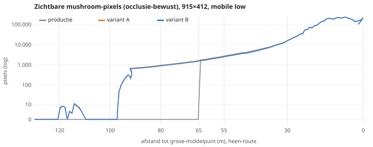
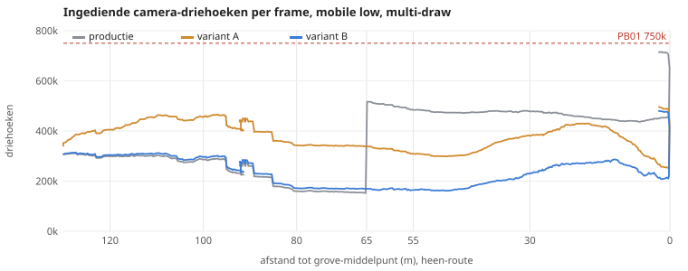
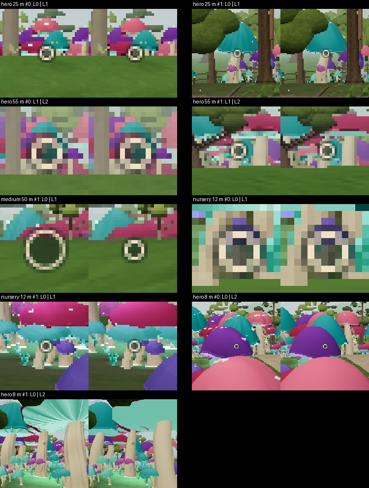

# VIS-R01AB — Mushroom Grove draw distance & LOD

16 oktober 2026. **Status: implementatievoorstel op featurebranch, wacht op visuele goedkeuring. Niet gemerged, niet gedeployed.**

**Besluit (voorstel): variant B — silhouette-preserving LOD — als default (`GROVE_LOD_PROFILE` `b`); variant A blijft selecteerbaar met `?grovelod=a`.**

## 1. Repository-checkpoint en branch

| | |
|---|---|
| Productie (default branch) | `ccr-75ef4113-kfkimm` @ `436e106` ("Merge DEV-04D D3-b2 + D3-b2R release closeout docs (#55)"), Pages-run 463 *success* (16-10 06:17 UTC). Remote `HEAD` → deze branch. |
| Referentie | `74610c56` is voorouder van `436e106`; de grove-code (`mushroomGrove.ts`, `mushroomModels.ts`, `mushroomField.ts`) is daartussen ongewijzigd. |
| Werkbranch | `ccr-4d8839a0-1oilxp`, gestart op `436e106` (geen andere branch gereset, gemerged of overschreven). |
| Productie tijdens het werk verschoven | Naar `d508e45` (SKY-C01-R01 wolkenshader #57, PORTAL-R01 hal-keukenboog #59/#60). Geen overlappende bestanden, geen conflicten; **productie is in de featurebranch gemerged** (merge-commit, geen rebase). Alle vergelijkende metingen in dit rapport zijn tegen `436e106` (identieke grove-code); de geïntegreerde build is opnieuw door unit-tests en de browser-gate gehaald (§8). |
| Parallel werk | VEG-R02: `recovery/veg-r02-missing-checkpoint` (alleen docs), `veg-art-r02-oak-sculpt` / PR #31 (alleen `woodkit.ts`). Deze branch raakt `woodkit.ts`, `boslustSample.ts` (TreeBatches/PlantBatch) en `vegbatch.ts` **niet**; `vegetationLod.ts` krijgt alleen nieuwe exports. Open PR's #49, #31, #9 zijn niet aangeraakt. |
| CI | De push naar deze branch draait typecheck + unit tests + build (geen deploy: alleen de default branch deployt). |

## 2. Technische root-cause-analyse

Vastgesteld op productie `436e106` (code + metingen, niet aangenomen):

| # | Bevinding | Bewijs | Effect |
|---|---|---|---|
| R1 | **Eén harde grens voor de hele grove**: `root.visible = hypot(player − MUSHROOM) < 65` (`mushroomGrove.ts:158`, ongewijzigd t.o.v. `74610c56`: `git diff 74610c5 436e106` op de grove-bestanden is leeg). Gemeten vanaf het *middelpunt*, niet per paddenstoel. | Route-meting: 80 m → 0 zichtbare mushroom-pixels, 64 m → 1.704 px in één frame; alle 302 instanties wisselen in hetzelfde frame. | De primaire popping-oorzaak. Omdat de grove ~37 × 30 m groot is, verschijnen de dichtstbijzijnde exemplaren op ~45 m (nearest 45,2 m bij de 65 m-grens) en aan de verre zijde pas op ~85 m: de grens ligt midden in het open zicht, niet in de haze. |
| R2 | **Alles-of-niets frustum culling**: 12 `InstancedMesh`es (4 soorten × hero/small/young) met één bounding sphere over het hele gebied. | Centrum: 110 van 302 in beeld, toch alle 302 ingediend; mushrooms 358,5k van 707.889 camera-driehoeken (94 % van PB01's 750k). | Onnodige geometrie: zodra een mesh-bol de view raakt, gaan álle instanties (ook achter de camera) naar de GPU. Er verdwijnt niets zichtbaar onterecht (de bol is conservatief) – de batch valt dus wél gedeeltelijk buiten beeld zonder zichtbare verliezen, maar tegen hoge kosten. |
| R3 | **Nursery domineert de kosten**: 241 jonge paddenstoelen × 728 tri = 175k, terwijl een typische nursery (0,5 m) op 30 m ~5 px hoog is (max 1,2 m ≈ 12 px). Hero 31 × 4.694 = 146k. | Geometrie-probe + views. | Geen LOD: een 4 m hoge hero op 60 m (~20 px op 412 px hoogte) kost evenveel als op 3 m. |
| R4 | **Lichtaantal en eerste render wisselen met de grens**: de 2 grove-PointLights hangen onder `root`; bij 65 m gaat het aantal zichtbare lichten 3 → 5 en worden alle 12 meshes in hetzelfde frame voor het eerst getekend. | Wandeling: frame op 64,9 m kost 1.344 ms (mediaan 308 ms, SwiftShader); `renderer.info.programs` verandert daar níet (de 5-lichtvarianten bestaan al). | Een eenmalige hapering precies op het moment van de pop. Daarnaast kost tussen 45–65 m elk verlicht fragment in beeld 2 extra lichtlussen terwijl de intensiteit al 0 is (de curve `1−(d−10)/35` is 0 vanaf 45 m). De programmawissels op 24 m en in het centrum komen van Mushroom Vision (render-target-varianten) en zijn ongewijzigd productiegedrag. |
| R5 | **Fog bepaalt geen grens**: woodland-haze [7, 102] m, open estate [16, 165] m, afhankelijk van de camerapositie. three.js mengt met `smoothstep(near, far, diepte)`: op 65 m (open) is de mistfactor 0,25 en voor de dichtstbijzijnde exemplaren (45 m) 0,10 — de grove verschijnt op 75–90 % zichtbaarheid. | `scene.fog` per meetpunt. | Een grens van 65 m wordt niet door mist verborgen; pas voorbij ~150 m (open) zou dat zo zijn. |
| R6 | **Andere afstandsgrenzen**: World-cullables (16 + 25·radius ⇒ > 600 m voor de grove: nooit actief), `VEG_FAR` 105 m (alleen chunk-vegetatie), bomen tot 115 m (Hybrid 22/36/62). Geen conflict met postprocessing: Mushroom Vision hangt alleen van de spelerpositie af (veld 0 buiten de grove-zone) en rendert pas bij intensiteit > 0. | Code + metingen. | Alleen R1 veroorzaakt de pop; R2–R4 zijn de kosten- en haperingsoorzaken. |
| R7 | **Camera-gedrag**: draaien, stilstaan, voor- en achteruitlopen veranderen niets aan de selectie behalve het oversteken van 65 m (geen hysteresis: ±1,5 m schuifelen rond 65 m gaf ≥ 2.288 zichtbare pops — 286 mushrooms per oversteek, in beide renderpaden). | `turn`, `still`, `toggle`-metingen. | Bevestigt R1 als enige zichtbare oorzaak. |

## 3. Baseline-metingen (productie `436e106`)

Opzet: `scripts/vis-r01-grove.mjs` (reproduceerbaar; zie §8). Mobile low (DPR 1, schaduwen uit, 3 pool-lichten), 915×412 CSS = drawing buffer, Chromium 141 headless + **SwiftShader (software-GPU)**, multi-draw tenzij vermeld. Route over de bestaande paden: `cottageReturn (48,168) → (79,160) → (90,139) → terraslantaarn-knoop (91,5,130,5) → eastGardenLoop (94,127) → (124,132) → (149,145) → (166,140) → mushroomApproach → (181,162)`, terug langs dezelfde route **achteruit lopend** (blik op de grove). Beweging via de echte autopilot + collision (3,2 m/s, 30 Hz), geen teleports. Meetpunten zijn het eerste routepunt op 120/100/80/65/55/30 m van het grove-middelpunt (179,160) plus het centrum; een pose met een stam vlak voor de lens schuift ≤ 6 m langs de route.

Nieuw meetinstrument: **zichtbare mushroom-pixels** — het frame twee keer renderen, met en zonder de mushroom-meshes (via `layers`, dus zonder de lichtconfiguratie te veranderen) en de verschillende pixels tellen. Dit is occlusie- en mistbewust: het telt wat de speler werkelijk ziet, inclusief bomen ervoor.

Productie, mobile low, landscape, dag, multi-draw (fallback-pad tussen haakjes: calls):

| Afstand | Calls | Camera-driehoeken | waarvan mushrooms ingediend | Getekend hero/medium/nursery | Zichtbare mushroom-px | Dichtstbijzijnde mushroom | Mist (near–far) | Lichten |
|---:|---:|---:|---:|---|---:|---:|---|---:|
| 120 m | 56 (104) | 299k | 0 | 0/0/0 | 0 | 103,2 m | 16–165 (open) | 3 |
| 100 m | 49 (102) | 288k | 0 | 0/0/0 | 0 | 82,8 m | 7–102 (bos) | 3 |
| 80 m | 27 (51) | 159k | 0 | 0/0/0 | **0** (vrij zicht, zie blad) | 60,7 m | 16–165 | 3 |
| 65 m | 40 (69) | 516k | 358,5k | 31/30/241 | 1.704 | 45,2 m | 16–165 | 5 |
| 55 m | 35 (65) | 484k | 358,5k | 31/30/241 | 2.719 | 35,3 m | 16–165 | 5 |
| 30 m | 30 (75) | 478k | 358,5k | 31/30/241 | 15.834 | 10,8 m | 16–165 | 5 |
| centrum | 96 (136) | **708k** (94 % PB01) | 358,5k (110 van 302 in beeld) | 31/30/241 | 92.828 | 2,2 m | 7–102 | 5 |

Desktop high (1280×720, schaduwen aan): centrum 803k, 65 m 675k. Portrait 412×915: centrum 607k, 65 m 466k. Avond (dusk 1): identieke counts, zichtbare pixels ±0,2 %. Op de wandeling: 587 zichtbare pops¹, 286 mushrooms in één frame (heen op 64,9 m, terug op 65,7 m), eerste zichtbaarheid 64,3 m, max 715k driehoeken / 97 calls, SwiftShader-frametijd mediaan 308 ms / p95 401 ms, uitschieter 1.344 ms op het popmoment. Rotatie en stilstand: geen wissels; schuifelen rond 65 m: ≥ 2.288 pops¹.

¹ *Pop = een exemplaar dat in twee opeenvolgende frames in beeld is en verschijnt/verdwijnt met een projectiehoogte × fade-schaal × (1 − mist) ≥ 2 px. Mist volgens three.js (`smoothstep(near, far, diepte)`, Euclidische afstand als diepte). De eerste runs wogen lineair; de wandelingen zijn uit de opgeslagen events herberekend (productie 572 → 587; A/B blijven 0 — hun grootste exemplaar is bij verschijnen 1,6 px, ook zonder mist). Voor het schuifelen zijn alleen samenvattingen bewaard: 2.288 is daar een ondergrens.*


## 4. Varianten en vergelijking

Beide varianten gebruiken hetzelfde mechanisme — dat is de duurzame basis — en verschillen alleen in profieldata (`GROVE_LOD_PROFILES` in `vegetationLod.ts`):

* Alle 302 mushrooms in **één `VegBatch`** (de bestaande abstractie van TreeBatches/PlantBatch): met multi-draw één `BatchedMesh` = **1 draw call met per-instantie frustum culling**; zonder (`?multidraw=0`) één `InstancedMesh` per geometrie met alleen de zichtbare instanties gepakt.
* Per mushroom eigen afstand (niet tot het middelpunt), per categorie banden met hysteresis (`selectTreeLod`, dezelfde functie als de boom-LOD) en een **schaal-fade over de laatste meters** (zoals PlantBatch, in 1/12-stappen): niets verschijnt of verdwijnt op volle grootte.
* Categorieën = de bestaande lagen: **hero** (`hero`, 31), **medium** (`small`, 30), **nursery** (`young`, 241). Omgevingseffecten: lichtpoelen + sporen faden in opaciteit (uniform, geen extra pass), gloeiende ondergroei met ±3 m hysteresis, beide gemeten vanaf de **grove-omtrek**; de twee PointLights verlaten de scène waar hun intensiteit al 0 was (45 m, hysteresis tot 47 m) i.p.v. bij 65 m.

| Categorie | A: geometrie · bereik | B: geometrie per band (m) · fade | Hypothese opdracht |
|---|---|---|---|
| Hero | detailed (4.694 tri) · 0–125, fade 105–125 | detailed 0–25 · small (1.252) 25–55 · **far (200)** 55–125 · fade 105–125 · hysteresis 3 | 0–25 / 25–55 / 55–125 |
| Medium | small · 0–105, fade 90–105 | small 0–50 · **far (200)** 50–105 · fade 90–105 · hysteresis 3 | 0–20 / 20–50 / 50–105 |
| Nursery | young (728) · 0–32, fade 24–32 | young 0–12 · **youngFar (200)** 12–32 · fade 24–32 · hysteresis 2 | 0–12 / 12–24 / 24–32 |

Medium heeft geen apart near-model: de goedgekeurde medium-geometrie ís het `small`-model; een gedetailleerder model dichtbij zou de goedgekeurde vormgeving veranderen. De 20 m-grens uit de hypothese is daarom een no-op en vervalt.

Identieke route en camera (deterministische autopilot: 1.090 samples per build, gelijke poses), mobile low, multi-draw:

| | Productie | Variant A | **Variant B** |
|---|---:|---:|---:|
| Zichtbare pops (instantie in beeld verschijnt/verdwijnt ≥ 2 px na mist¹) | **587** | 0 | **0** |
| Grootste pop in één frame | **286 mushrooms** (0 → 1.755 px tussen 65,2 en 64,3 m) | – | – |
| Eerste herkenbaarheid (≥ 50 / ≥ 500 zichtbare mushroom-px, heen) | 64,3 / 64,3 m | 96,5 / 91,7 m | **96,1 / 91,7 m** |
| Grootste sprong zichtbare px voorbij 35 m | **+1.755** (0 → 1.755, 65,2 → 64,3 m) | −822 (beweging bij 36 m) | −831 (idem; productie daar −804) |
| Camera-driehoeken mediaan ≥ 65 m / 30–65 m / < 30 m | 263k / 484k / 463k | 411k / 329k / 401k | **274k / 189k / 274k** |
| Camera-driehoeken max (route) | 715k (95 % PB01) | 497k | **480k** (64 % PB01) |
| Draw calls max (multi-draw) | 97 | 85 | **85** |
| LOD-wissels in beeld (max hoogte object) | – | – | 454 (max 108 px hoog); per exemplaar, overgang en richting hooguit één wissel — geen oscillatie |
| Draaien 360° op 55/65/80 m — toestandswissels | 0 | 0 | 0 |
| Stilstaan op 24,5–65,5 m (90 frames) — wissels | 0 | 0 | 0 |
| Heen-en-weer ±1,5 m rond 65 m — zichtbare pops | **≥ 2.288** | 0 | 0 |
| Hapering eerste nadering (SwiftShader) | 1.344 ms op 65 m (alle meshes + lichtwissel tegelijk) | — | 986 ms op 45 m (het frame van de lichtwissel 3 → 5; geen nieuwe programma's, zie §9) |
| SwiftShader frametijd mediaan / p95 (software, **geen telefoon-FPS**) | 308 / 401 ms | 334 / 425 ms | 290 / 381 ms |





De kleine piek rond 112–120 m (≤ 10 px) en de stijging rond 96 m zijn zichtlijnen die tussen de bomen opengaan: daar staan alle heroes al op volle schaal (hun fade ligt op 105–125 m van het exemplaar), dus het is occlusie, geen pop. In het mistige bos (haze 7–102 m) blijft de grove verder vanzelf verborgen; vanaf het open estate (16–165 m) is hij vanaf ~96 m zichtbaar.

**Wat een LOD-wissel kost** (`lodpop`: twee geforceerde niveaus op de wisselafstand, pixels rond het exemplaar): 

| Overgang | exemplaren | mediaan % px Δ>24 | max % px Δ>24 |
|---|---:|---:|---:|
| hero@25 L0->L1 | 6 | 5.72 | 7.57 |
| hero@55 L1->L2 | 6 | 3.46 | 6.25 |
| medium@50 L0->L1 | 5 | 3.36 | 14.81 |
| nursery@12 L0->L1 | 6 | 6.94 | 10.09 |
| hero@8 L0->L2 | 6 | 10.55 | 18.85 |
| nursery@4 L0->L1 | 6 | 6.77 | 9.88 |
| medium@6 L0->L1 | 6 | 3.71 | 7.46 |



*8 m-rijen tonen het far-model geforceerd van dichtbij, alleen ter controle van silhouet en verf (in het spel pas vanaf 55 m). De medium-uitschieter (14,8 %) komt mede van de UI-reticle die in één opname van grootte wisselt.*


**Crossfade.** Niet geïmplementeerd, op basis van deze metingen: een wissel verandert in de mediaan 3,4–6,9 % van de pixels in een uitsnede van ≤ 80 px rond het object (bovengrens: de forcering geldt voor alle exemplaren, dus buren in de uitsnede wisselen mee) — enkele tientallen pixels op 377k, één keer per exemplaar per richting dankzij de hysteresis. Een dithered crossfade zou dat hooguit over ~1 s uitsmeren, maar vraagt (a) twee instanties per overgangsexemplaar in de batch en (b) `discard` in de fragment shader van de hele mushroom-batch, wat op tile-based mobiele GPU's early-Z/HSR voor alle mushroom-fragmenten uitschakelt — elke frame, ook zonder overgang. Alpha-blending zou daarnaast sorteren en overdraw toevoegen. De meetbare winst rechtvaardigt die permanente fragmentkosten niet. Kleine objecten (nursery, ver weg alle categorieën) faden wél, via schaal (geen transparantie, geen extra pass).


## 5. Gekozen oplossing en onderbouwing

**Variant B.** Beide varianten lossen de pop volledig op (0 vs 587 zichtbare pops) en maken de grove ~32 m eerder herkenbaar (96 m vs 64 m). Het verschil is de prijs:

* **A** tekent de volledige geometrie tot 125 m: in de verre band (≥ 65 m) **+56 %** camera-driehoeken t.o.v. productie, terwijl een hero daar 10–30 px hoog is. Dat is extra zichtbaarheid gekocht met vertexwerk dat de speler niet ziet — en het schuift het budget op naar plekken (de open estate-zichtlijnen) waar andere content (bomen tot 115 m, manor) ook concurreert.
* **B** levert dezelfde zichtbare dekking (op 80 m 886 vs A 936 px, op 30 m 15.432 vs 15.562 px: −1 à −5 %, het 12-hoekige far-silhouet) voor **+4 %** in de verre band, **−61 %** tussen 30–65 m en **−41 %** binnen 30 m, en verlaagt het route-maximum van 715k naar 480k (PB01-marge van 35k naar 270k).
* De far-geometrie is een herparametrisatie van exact dezelfde oppervlakken (zelfde stengelbocht, hoedprofiel, rand, lip, gloeiende onderkant), dus de silhouetten blijven consistent: hoogte binnen 2 %, hoedbreedte binnen 8 %, hoed- en stengelverf binnen 0,03 per kanaal (unit-tests), en een LOD-wissel verandert in de mediaan 3,4–6,9 % van de pixels rond het object.
* Heroes binnen 25 m, medium binnen 50 m en nursery binnen 12 m gebruiken het goedgekeurde model ongewijzigd. Variant A (alleen goedgekeurde modellen) is in het centrum **bit-identiek** aan productie (JPEG-diff 0,0): de nieuwe batch-route (voorgespiegelde geometrie, geconjugeerde matrices, glow-data via instance colour) levert exact dezelfde shading. B wijkt daar 0,11 % van de pixels af (de verder weg staande exemplaren op mid/far).

Waarom geen grotere afstanden: voorbij ~125 m is een hero ≤ 10 px, in open terrein voor ~70 % in mist en in het bos volledig (haze-einde 102 m); de visuele winst is dan nihil. Waarom nursery niet verder dan 32 m: op 30 m leveren alle nursery-exemplaren voorbij 32 m samen ~1,7 % van de zichtbare grove-pixels (15.834 vs 15.562), terwijl productie er 175k driehoeken aan uitgaf.


## 6. Gewijzigde bestanden

| Bestand | Wijziging |
|---|---|
| `src/world/mushroomGrove.ts` | 12 InstancedMeshes + 65 m-gate → één VegBatch met per-instantie LOD/fade; voorgespiegelde geometrie (`mirrorGeometry`) + geconjugeerde matrices i.p.v. de gespiegelde root; glow/fase-data via het instance-colour-kanaal; ambient-groepen (lichten, poelen+sporen, ondergroei) met eigen afstandsregels; diagnostiek `groveSnapshot` / `groveForceLevel` / `grovePath` / `groveProfile`. Plaatsingen, transforms, colliders, licht- en pulse-formules ongewijzigd. |
| `src/world/mushroomModels.ts` | Optionele `far`-tessellatie (gedeelde grove ringset, geen lamellen/schubben, geen aliasende verftermen) voor `mushroomModel` en `mushroomYoungModel`. Bestaande modellen bit-identiek (hash + fixture-test). |
| `src/world/vegetationLod.ts` | Alleen toevoegingen: `VegLodBands`, `rangeFade`, `GroveLodProfile`, `GROVE_LOD_PROFILES` (a, b), `?grovelod=`. Boomprofielen onaangeroerd. |
| `tests/visR01.test.ts` | Fades, bandvolgorde/hysteresis, oscillatievrijheid, goedgekeurde modellen (fixture uit `436e106`), far-silhouet (hoogte, breedte, verf, attribuutcompatibiliteit), exacte spiegeling (posities, normalen, winding). |
| `scripts/vis-r01-grove.mjs` | Meetharnas (views, walk, turn, still, toggle, lodpop, gameplay, `CHECK=1`-gate). |
| `scripts/vis-r01-tables.py`, `vis-r01-sheets.py`, `vis-r01-crops.py`, `vis-r01-chart.py` | Tabellen, vergelijkingsbladen, 2×-uitsneden, SVG-grafieken. |
| `docs/vis-r01/` | Dit rapport, bladen, grafieken, video's, ruwe JSON-samenvattingen. |

## 7. Screenshots en bewegende vergelijking

Alle beelden: identieke poses per build (zelfde route, zelfde camera), labels in beeld. *Kolommen: productie · A · B (of final = default B).*

| Bestand | Inhoud |
|---|---|
| [`sheets/pop-66m-vs-64m-prod-a-b.jpg`](sheets/pop-66m-vs-64m-prod-a-b.jpg) | **Het popmoment**: twee opeenvolgende wandelframes (66,4 m en 64,3 m), uitsnede rond de grove. Productie: leeg → hele grove. A/B: in beide frames aanwezig. |
| [`sheets/compare-low-day.jpg`](sheets/compare-low-day.jpg), [`compare-low-dusk.jpg`](sheets/compare-low-dusk.jpg) | Mobile low landscape, 120/100/80/65/55/30 m en centrum, dag en avond. |
| [`sheets/crops-low-day.jpg`](sheets/crops-low-day.jpg), [`crops-low-dusk.jpg`](sheets/crops-low-dusk.jpg) | 2×-uitsneden rond de grove (120/80/65/55/30 m): herkenbaarheid van de silhouetten. |
| [`sheets/compare-high-desktop-day.jpg`](sheets/compare-high-desktop-day.jpg), [`crops-high-desktop.jpg`](sheets/crops-high-desktop.jpg) | Desktop high 1280×720 (schaduwen aan): productie · final dag · final avond. |
| [`sheets/compare-portrait-day.jpg`](sheets/compare-portrait-day.jpg) | Portrait 412×915: productie · final. |
| [`sheets/compare-low-day-instanced.jpg`](sheets/compare-low-day-instanced.jpg) | `?multidraw=0`-fallback: hetzelfde beeld als multi-draw. |
| [`sheets/lod-switch-pairs.jpg`](sheets/lod-switch-pairs.jpg) | LOD-wisselparen op de wisselafstand (+ far-model van dichtbij ter controle). |
| [`video/walk-prod-vs-b.mp4`](video/walk-prod-vs-b.mp4) | Volledige wandeling heen (vooruit) en terug (achteruit), productie naast B, met afstand/driehoeken/calls in beeld (20 fps, ~2× sneller dan realtime). |
| [`video/grove-crop-heen-prod-a-b.mp4`](video/grove-crop-heen-prod-a-b.mp4), [`grove-crop-terug-prod-a-b.mp4`](video/grove-crop-terug-prod-a-b.mp4) | 2×-uitsnede rond de grove, 105 → 45 m heen en 45 → 105 m terug, productie · A · B. |
| [`charts/walk-visible-pixels.svg`](charts/walk-visible-pixels.svg), [`walk-triangles.svg`](charts/walk-triangles.svg) | Grafieken uit §4. |
| [`results.json`](results.json) | Alle metingen (views, wandelingen per sample, rotatie, stilstand, schuifelen, lodpop, gameplay, gates) van productie, A, B en final. |

Visuele beoordeling (eigen waarneming op de bladen en video's, ter toetsing door de eigenaar):

* **Eerste herkenbaarheid**: grote hoeden (roze wine-shelf, paars violet-bell, mint-lantern) zijn op 80 m als kleurrijke vormen boven het gras herkenbaar, op desktop duidelijk; op telefoonresolutie klein maar onmiskenbaar. Productie toont op 80 m niets.
* **Popping**: geen enkel exemplaar verschijnt op volle grootte in beeld (0 zichtbare pops, ook achteruitlopend en in beide renderpaden); de grove "groeit" in beeld mee met de afstand. LOD-wissels zijn in de wisselparen op de wisselafstand nauwelijks te onderscheiden (§4); of ze tijdens het lopen opvallen, is precies wat de video's de eigenaar laten beoordelen — ik heb de video's alleen steekproefsgewijs per frame bekeken.
* **Silhouetten**: hoed, stengel en kleurverdeling blijven op de wisselafstanden gelijk; het far-model verliest de lamellen en schubben, wat pas onder ~15 m opvalt (en daar niet gebruikt wordt).
* **Kleine mushrooms**: nursery-kolonies groeien tussen 32 en 24 m uit het niets op (schaal), wat bij lopen natuurlijk oogt; op 30 m mist er ~1,7 % van de grove-pixels t.o.v. productie (de nursery verder dan 32 m).
* **Sfeer**: lichtpoelen en sporen faden in tussen 55 en 35 m van de grove-rand; de grove-gloed (vertex-glow, kolonie-puls) is identiek omdat de shader-data per exemplaar exact behouden is (zie A-centrum bit-identiek). Avondbeelden: gloed en kleuren ongewijzigd.
* **Camera-rotatie**: 0 toestandswissels bij 360° draaien op 55/65/80 m; selectie hangt alleen van afstand af.
* **Kosten**: zie §4 — B maakt de grove ~32 m eerder zichtbaar voor +4 % driehoeken in de verre band, en is binnen 65 m 41–61 % goedkoper dan productie.


## 8. Unit-, browser- en performanceresultaten

| Check | Resultaat |
|---|---|
| `npm run typecheck` | schoon |
| `npm test` (vitest) | **42 bestanden / 395 tests groen**, waarvan 6 nieuw (`tests/visR01.test.ts`); bestaande mushroom-, vegbatch- en vegetationLod-tests ongewijzigd groen |
| `npm run test:budget` (PB01-policy) | 4/4 |
| `npm run build` | OK (bestaande chunk-grootte-waarschuwing ongewijzigd) |
| CI op de branch (Pages-workflow: typecheck + test + build, geen deploy) | run 467 *success* op `fe8968c`; de eindcommit triggert opnieuw |
| Geteste bundel = broncode | `dist` van de metingen inhoudelijk identiek aan een verse build van de eindbron (alleen de build-ID verschilt) |
| **Rendering/LOD** (`scripts/vis-r01-grove.mjs`, `CHECK=1`) | final multi-draw én `?multidraw=0`: **PASS** — ≤ 150 calls, ≤ 750k driehoeken op alle views en de hele wandeling (mobile low), 0 zichtbare pops, 0 wissels bij draaien/stilstaan, 0 pops bij schuifelen, 0 paginafouten |
| **Collision/gameplay** (`MODE=gameplay`) | productie en final identiek: 114 colliders rond de grove (40 mushroom), zelfde hash; 302 plaatsingen, zelfde hash; wandeling door de grove eindigt op exact dezelfde positie (180,88 / 161,81); Mushroom Vision piek 1 → herstel 0; progressie (flags, clues, inventaris, deuren) ongewijzigd |
| **Bestaande grove-QA** (`scripts/mushroom-qa.mjs`, `CHECKS=1`) | groen: zone-lifecycle, grove-audiobus (binnen 0,45 / gepauzeerd 0,002 / buiten 0), mute, reduced motion (motion/distort/clock 0), distortion-toggle, **Vision-klok 12 bij t=10 s (animatiesnelheid ongewijzigd)**, footstep-banken, WebGL context-loss + herstel zonder GL-fout |
| **Volledige e2e** (`scripts/e2e.mjs`, idle machine, productie vs kandidaat) | beide **89/97 met exact dezelfde 8 fouten**, die dus al op productie bestaan: 7× de bestaande high/desktop-check (270 calls / 450k gecombineerd, o.a. gate 575k, conservatory 621k in productie) en 1× `page.goto`-timeout in de BOSLUST-sample. Alle collision-, save-, licht-, touch-, interactie- en walkthrough-checks groen in beide. Verschillen kandidaat − productie: forecourt (low) +1 call / +800 tri, conservatory pool (low) +1 / +11,6k (verre heroes in zicht, verklaarde groei); BOSLUST cut +1 call bij gelijke driehoeken is e2e-ruis (gerichte meting: 74 = 74 calls, de grove draagt daar niets bij). Een eerdere e2e-run tijdens parallelle metingen gaf extra time-outs; die run is verworpen. |
| **Geïntegreerd met productie `d508e45`** (merge `71834fb`) | typecheck schoon; **44 bestanden / 404 tests** (incl. nieuwe SKY-C01-R01/PORTAL-R01-tests); budget 4/4; build OK; browser-gate (`views,turn,still,toggle,gameplay`, `CHECK=1`) **PASS** op multi-draw en `?multidraw=0`, alle 7 meetpunten exact gelijk aan de geteste final-build (calls, driehoeken, zichtbare pixels), gameplay-fingerprints identiek. Wandeling, video's en e2e zijn niet opnieuw gedraaid op de geïntegreerde build. |
| Dag/avond, desktop/portrait/landscape | §3/§4-tabellen en bladen: alle 8 final-configuraties zonder paginafouten; avond = zelfde counts, pixels ±0,2 % |
| Android-hardware | **Niet beschikbaar in deze omgeving.** Geen telefoonmeting; de SwiftShader-tijden zijn geen FPS. |

Volledige tabellen (alle builds × configuraties) en het meetprotocol:

<details><summary>Alle meettabellen</summary>

##### Mobile low · landscape 915×412 · dag · multi-draw — calls · driehoeken · zichtbare mushroom-px · getekend hero/medium/nursery

| Afstand | prod-low-landscape-day-multidraw | a-low-landscape-day-multidraw | b-low-landscape-day-multidraw | final-low-landscape-day-multidraw |
|---:|---:|---:|---:|---:|
| 120 m | 56 · 299.2k · 0 px · 0/0/0 | 57 · 405.0k · 7 px · 22/2/0 | 57 · 304.0k · 7 px · 22/2/0 | 57 · 304.0k · 7 px · 22/2/0 |
| 100 m | 49 · 288.3k · 0 px · 0/0/0 | 50 · 461.3k · 0 px · 31/22/0 | 50 · 298.9k · 0 px · 31/22/0 | 50 · 298.9k · 0 px · 31/22/0 |
| 80 m | 27 · 159.2k · 0 px · 0/0/0 | 28 · 342.3k · 936 px · 31/30/0 | 28 · 171.4k · 886 px · 31/30/0 | 28 · 171.4k · 886 px · 31/30/0 |
| 65 m | 40 · 516.5k · 1704 px · 31/30/241 | 28 · 338.3k · 1623 px · 31/30/0 | 28 · 169.5k · 1542 px · 31/30/0 | 28 · 169.5k · 1542 px · 31/30/0 |
| 55 m | 35 · 484.5k · 2719 px · 31/30/241 | 24 · 309.0k · 2562 px · 31/30/0 | 24 · 164.4k · 2495 px · 31/30/0 | 24 · 164.4k · 2495 px · 31/30/0 |
| 30 m | 30 · 478.0k · 15834 px · 31/30/241 | 19 · 381.2k · 15562 px · 31/30/108 | 19 · 231.5k · 15432 px · 31/30/108 | 19 · 231.5k · 15432 px · 31/30/108 |
| 0 m | 96 · 707.9k · 92828 px · 31/30/241 | 85 · 491.8k · 92780 px · 31/30/241 | 85 · 459.0k · 92710 px · 31/30/241 | 85 · 459.0k · 92710 px · 31/30/241 |

##### Mobile low · landscape · dag · InstancedMesh-fallback (?multidraw=0) — calls · driehoeken · zichtbare mushroom-px · getekend hero/medium/nursery

| Afstand | prod-low-landscape-day-instanced | a-low-landscape-day-instanced | b-low-landscape-day-instanced | final-low-landscape-day-instanced |
|---:|---:|---:|---:|---:|
| 120 m | 104 · 299.2k · 0 px · 0/0/0 | 110 · 405.0k · 7 px · 22/2/0 | 108 · 304.0k · 7 px · 22/2/0 | 108 · 304.0k · 7 px · 22/2/0 |
| 100 m | 102 · 288.3k · 0 px · 0/0/0 | 110 · 461.3k · 0 px · 31/22/0 | 106 · 298.9k · 0 px · 31/22/0 | 106 · 298.9k · 0 px · 31/22/0 |
| 80 m | 51 · 159.2k · 0 px · 0/0/0 | 59 · 342.3k · 936 px · 31/30/0 | 55 · 171.4k · 886 px · 31/30/0 | 55 · 171.4k · 886 px · 31/30/0 |
| 65 m | 69 · 516.5k · 1704 px · 31/30/241 | 64 · 338.3k · 1623 px · 31/30/0 | 62 · 169.5k · 1542 px · 31/30/0 | 62 · 169.5k · 1542 px · 31/30/0 |
| 55 m | 65 · 484.5k · 2719 px · 31/30/241 | 61 · 309.0k · 2562 px · 31/30/0 | 61 · 164.4k · 2495 px · 31/30/0 | 61 · 164.4k · 2495 px · 31/30/0 |
| 30 m | 75 · 478.0k · 15834 px · 31/30/241 | 75 · 381.2k · 15562 px · 31/30/108 | 77 · 231.5k · 15432 px · 31/30/108 | 77 · 231.5k · 15432 px · 31/30/108 |
| 0 m | 136 · 707.9k · 92769 px · 31/30/241 | 136 · 491.8k · 92821 px · 31/30/241 | 140 · 459.0k · 92710 px · 31/30/241 | 140 · 459.0k · 92641 px · 31/30/241 |

##### Mobile low · landscape · avond (dusk 1) · multi-draw — calls · driehoeken · zichtbare mushroom-px · getekend hero/medium/nursery

| Afstand | prod-low-landscape-dusk-multidraw | a-low-landscape-dusk-multidraw | b-low-landscape-dusk-multidraw | final-low-landscape-dusk-multidraw |
|---:|---:|---:|---:|---:|
| 120 m | 56 · 299.2k · 0 px · 0/0/0 | 57 · 405.0k · 7 px · 22/2/0 | 57 · 304.0k · 7 px · 22/2/0 | 57 · 304.0k · 7 px · 22/2/0 |
| 100 m | 49 · 288.3k · 0 px · 0/0/0 | 50 · 461.3k · 0 px · 31/22/0 | 50 · 298.9k · 0 px · 31/22/0 | 50 · 298.9k · 0 px · 31/22/0 |
| 80 m | 27 · 159.2k · 0 px · 0/0/0 | 28 · 342.3k · 941 px · 31/30/0 | 28 · 171.4k · 889 px · 31/30/0 | 28 · 171.4k · 889 px · 31/30/0 |
| 65 m | 40 · 516.5k · 1706 px · 31/30/241 | 28 · 338.3k · 1625 px · 31/30/0 | 28 · 169.5k · 1545 px · 31/30/0 | 28 · 169.5k · 1545 px · 31/30/0 |
| 55 m | 35 · 484.5k · 2723 px · 31/30/241 | 24 · 309.0k · 2564 px · 31/30/0 | 24 · 164.4k · 2498 px · 31/30/0 | 24 · 164.4k · 2498 px · 31/30/0 |
| 30 m | 30 · 478.0k · 15870 px · 31/30/241 | 19 · 381.2k · 15598 px · 31/30/108 | 19 · 231.5k · 15463 px · 31/30/108 | 19 · 231.5k · 15463 px · 31/30/108 |
| 0 m | 96 · 707.9k · 91166 px · 31/30/241 | 85 · 491.8k · 91140 px · 31/30/241 | 85 · 459.0k · 90954 px · 31/30/241 | 85 · 459.0k · 90974 px · 31/30/241 |

##### High · desktop 1280×720 · dag · multi-draw — calls · driehoeken · zichtbare mushroom-px · getekend hero/medium/nursery

| Afstand | prod-high-desktop-day-multidraw | a-high-desktop-day-multidraw | b-high-desktop-day-multidraw | final-high-desktop-day-multidraw |
|---:|---:|---:|---:|---:|
| 120 m | 96 · 399.6k · 0 px · 0/0/0 | – | – | 97 · 404.4k · 28 px · 22/2/0 |
| 100 m | 77 · 415.5k · 0 px · 0/0/0 | – | – | 78 · 426.1k · 0 px · 31/22/0 |
| 80 m | 72 · 315.3k · 0 px · 0/0/0 | – | – | 73 · 327.5k · 3036 px · 31/30/0 |
| 65 m | 85 · 675.4k · 5682 px · 31/30/241 | – | – | 73 · 328.4k · 5202 px · 31/30/0 |
| 55 m | 75 · 648.2k · 8972 px · 31/30/241 | – | – | 64 · 328.2k · 8264 px · 31/30/0 |
| 30 m | 58 · 642.1k · 50187 px · 31/30/241 | – | – | 47 · 395.6k · 49008 px · 31/30/108 |
| 0 m | 138 · 803.1k · 215715 px · 31/30/241 | – | – | 127 · 549.5k · 215175 px · 31/30/241 |

##### Mobile low · portrait 412×915 · dag · multi-draw — calls · driehoeken · zichtbare mushroom-px · getekend hero/medium/nursery

| Afstand | prod-low-portrait-day-multidraw | a-low-portrait-day-multidraw | b-low-portrait-day-multidraw | final-low-portrait-day-multidraw |
|---:|---:|---:|---:|---:|
| 80 m | 22 · 105.6k · 0 px · 0/0/0 | – | – | 23 · 117.8k · 2650 px · 31/30/0 |
| 65 m | 39 · 466.0k · 5027 px · 31/30/241 | – | – | 27 · 119.0k · 4579 px · 31/30/0 |
| 55 m | 34 · 456.0k · 8090 px · 31/30/241 | – | – | 23 · 135.8k · 7408 px · 31/30/0 |
| 30 m | 30 · 438.4k · 29913 px · 31/30/241 | – | – | 19 · 170.2k · 28974 px · 31/30/108 |
| 0 m | 86 · 606.5k · 48561 px · 31/30/241 | – | – | 75 · 321.9k · 48440 px · 31/30/241 |

##### Wandeling heen (vooruit) en terug (achteruit), steeds kijkend naar de grove

| Build | samples | calls min–max | driehoeken min / mediaan / max | zichtbare pops (≥2 px na fog) | max pops in 1 frame | grootste sprong zichtbare mushroom-px voorbij 35 m | eerst ≥50 px / ≥500 px zichtbaar | LOD-wissels (max px) | programmawissels | SwiftShader ms mediaan / p95 |
|---|---:|---:|---:|---:|---:|---:|---:|---:|---:|---:|
| prod-low-landscape-day-multidraw | 1090 | 24–97 | 152k / 310k / 715k | 587 | 286 | +1755 px (65.21→64.29 m, in) | 64.29 m / 64.29 m | 0 (0) | 8 | 307.5 / 401.3 |
| a-low-landscape-day-multidraw | 1090 | 16–85 | 252k / 397k / 497k | 0 | 0 | -822 px (35.51→36.47 m, out) | 96.5 m / 91.66 m | 0 (0) | 9 | 334.1 / 424.6 |
| b-low-landscape-day-multidraw | 1090 | 16–85 | 162k / 256k / 480k | 0 | 0 | -831 px (35.51→36.47 m, out) | 96.12 m / 91.66 m | 454 (108) | 9 | 289.6 / 381.4 |

##### Draaien, stilstaan, heen-en-weer schuifelen

| Build | draaien 360° (55/65/80 m): toestandswissels | stilstaan (24,5–65,5 m): wissels | schuifelen ±1,5 m (25/55/65 m): zichtbare pops / LOD-wissels |
|---|---|---|---|
| prod-low-landscape-day-multidraw | 0 / 0 / 0 | 0 / 0 / 0 / 0 / 0 / 0 | 25 m: 0 / 0 · 55 m: 0 / 0 · 65 m: 2288 / 0 |
| a-low-landscape-day-multidraw | 0 / 0 / 0 | 0 / 0 / 0 / 0 / 0 / 0 | 25 m: 0 / 0 · 55 m: 0 / 0 · 65 m: 0 / 0 |
| b-low-landscape-day-multidraw | 0 / 0 / 0 | 0 / 0 / 0 / 0 / 0 / 0 | 25 m: 0 / 11 · 55 m: 0 / 0 · 65 m: 0 / 0 |
| final-low-landscape-day-multidraw | 0 / 0 / 0 | 0 / 0 / 0 / 0 / 0 / 0 | 25 m: 0 / 11 · 55 m: 0 / 0 · 65 m: 0 / 0 |
| prod-low-landscape-day-instanced | 0 / 0 / 0 | 0 / 0 / 0 / 0 / 0 / 0 | 25 m: 0 / 0 · 55 m: 0 / 0 · 65 m: 2288 / 0 |
| final-low-landscape-day-instanced | 0 / 0 / 0 | 0 / 0 / 0 / 0 / 0 / 0 | 25 m: 0 / 11 · 55 m: 0 / 0 · 65 m: 0 / 0 |

##### LOD-wissel: gewijzigde pixels rond het exemplaar (final-low-landscape-day-multidraw)

| Overgang | exemplaren | mediaan % px Δ>24 | max % px Δ>24 |
|---|---:|---:|---:|
| hero@25 L0->L1 | 6 | 5.72 | 7.57 |
| hero@55 L1->L2 | 6 | 3.46 | 6.25 |
| medium@50 L0->L1 | 5 | 3.36 | 14.81 |
| nursery@12 L0->L1 | 6 | 6.94 | 10.09 |
| hero@8 L0->L2 | 6 | 10.55 | 18.85 |
| nursery@4 L0->L1 | 6 | 6.77 | 9.88 |
| medium@6 L0->L1 | 6 | 3.71 | 7.46 |

</details>

Reproduceren (na `npm run build`, productie-dist in een eigen map):

```sh
DIST=dist TAG=final MODE=views,walk,turn,still,toggle,gameplay CHECK=1 node scripts/vis-r01-grove.mjs   # + MULTIDRAW=0, DUSK=1, QUALITY=high VIEWPORT=desktop, VIEWPORT=portrait
DIST=dist TAG=a PARAMS=grovelod=a MODE=walk node scripts/vis-r01-grove.mjs                                # varianten
DIST=dist TAG=final MODE=walk VIDEO=1 EVERY=3 SHOT_EVERY=3 PX_EVERY=0 FPS=20 node scripts/vis-r01-grove.mjs
DIST=dist TAG=final MODE=lodpop node scripts/vis-r01-grove.mjs
python3 scripts/vis-r01-tables.py OUT_DIR prod,a,b,final
```

Draai metingen sequentieel: parallelle SwiftShader-instanties vertragen elkaar 3–4× en maken de frametijden onvergelijkbaar.


## 9. Bekende beperkingen

1. **Geen fysieke mobiele hardware.** Alle metingen zijn Chromium 141 headless met SwiftShader (software-GPU). Frametijden zijn CPU-rasterisatietijden, **geen telefoon-FPS**; de PB01-device-validatie (Samsung, 10 min warm) blijft openstaan. Wat wél hardware-onafhankelijk is: calls, ingediende driehoeken, zichtbaarheid, pops, LOD-gedrag.
2. **Hapering bij de lichtwissel.** De twee grove-PointLights vallen buiten de LightPool; het aantal lichten wisselt 3 → 5. Productie doet dat op 65 m (samen met de grove-pop: 1.344 ms SwiftShader), B op 45 m waar de intensiteit al 0 is (986 ms SwiftShader, eenmalig bij de eerste nadering; op de terugweg en bij herhaling niet meer gemeten). Er komen geen nieuwe programma's bij (de varianten bestaan al), dus op een echte GPU is dit vermoedelijk veel kleiner — **niet op hardware geverifieerd**. Structurele oplossing (buiten scope, verandert lichtbeleving): de grove-lichten als vaste slots in de LightPool.
3. **Fallback-pad: +4 calls** in het centrum (140 vs 136) en op 80–120 m (bv. 108 vs 104) door 20 i.p.v. 12 geometriegroepen (5 per soort); op 30–65 m −7..+2. Binnen 150 (max 140).
4. **Verre band +4 % driehoeken.** Op 80–120 m kost de nieuwe zichtbaarheid +5..+12k camera-driehoeken (+1 call) t.o.v. productie, die daar niets tekende. Dit is bewuste, verklaarde groei (PB01 "explained growth"): absolute marge blijft > 250k.
5. **Afstand per exemplaar is 3D-afstand camera → voet van de paddenstoel**, niet projectiegrootte; een kleine hero (schaal 0,85 op het pad) en een reus (2,5) delen dus dezelfde band. Gemeten zonder zichtbaar effect; schermgrootte-selectie is een kandidaat voor VIS-R01C.
6. **Per-instantie culling in het fallback-pad gebeurt op de CPU** (bestaande `InstancedVeg`-logica, alleen bij camerabeweging); 302 instanties zijn verwaarloosbaar, maar dit is geen GPU-occlusion culling: mushrooms achter bomen worden nog steeds ingediend (zoals alle vegetatie).
7. **Data in het instance-colour-kanaal.** De grove gebruikt het enige per-instantie vec3-kanaal van VegBatch voor glow/fase (de albedo komt uit de vertexkleur). Werkt in beide paden en is gedocumenteerd in de shader; een tweede gebruiker die óók instance-kleur wil, heeft een apart datakanaal nodig (zie §10).
8. **Binnen het huis**: de grove wordt alleen nog getekend als `outdoorWindows` (open deur, kegel) het exemplaar toelaat — strenger dan productie (die tekende binnen 65 m altijd). Er is geen interieur binnen 65 m van de grove, dus niet visueel getest vanuit een interieur.
9. **Evidence-scope**: één route (de bestaande toegangsroute) plus de 7 meetpunten, rotatie op 3 punten, stilstand op 6, schuifelen op 3; dag en avond (dusk 1); 915×412, 412×915 en 1280×720. Andere zichtlijnen (bv. vanaf het noordelijke hek) zijn niet apart gemeten.


## 10. Overdracht naar VIS-R01C en VEG-R02

**Wat herbruikbaar is (VIS-R01C — gedeeld vegetatie-LOD):**

* `vegetationLod.ts` bevat nu het generieke deel: `VegLodBands` (`levels`, `hysteresis`, `exit`, `fade`), `rangeFade()` (gekwantiseerde schaal-fade, identiek aan wat `PlantBatch` inline doet) en `selectTreeLod()` (ongewijzigd, al generiek ondanks de naam). Voorstel voor C: één `VegLodBands`-tabel per vegetatiesoort, `PlantBatch` en de bush-tak van `TreeBatches` laten `rangeFade`/`VegLodBands` gebruiken, `selectTreeLod` hernoemen naar `selectLod` met een alias.
* Het patroon "één VegBatch, per instantie `{geometrie per level, bands, fade}`" uit `mushroomGrove.ts` (±40 regels in de `onFrame`-hook) is het minimale gedeelde LOD-object. Een `VegLodBatch`-klasse is in C de logische extractie; hier bewust nog niet gedaan om `TreeBatches`/`PlantBatch` (waar VEG-R02 aan werkt) niet aan te raken.
* De `outdoorWindows`-test staat nu twee keer (TreeBatches en grove): in C naar een helper in `vegetationLod.ts`.
* **Instance-data:** voeg in C een expliciet per-instantie datakanaal aan `VegBatch` toe (BatchedMesh: DataTexture via `getIndirectIndex(gl_DrawID)`; fallback: een extra `InstancedBufferAttribute` die `InstancedVeg.sync` meepakt). Dan kan de grove instance-colour weer als kleur gebruiken en kan VEG-R02 windfase/seizoenskleur per instantie meegeven.
* **Spiegelregel:** instance-matrices in een VegBatch moeten een positieve determinant hebben (de renderer kent alleen de determinant van het object, niet per instantie). Voor gespiegelde content: `mirrorGeometry()` + `S·M·S` (zie unit-test) i.p.v. een gespiegelde parent.
* **Meetinstrument:** `scripts/vis-r01-grove.mjs` werkt op elke build (ook zonder de nieuwe diagnostiek) en meet occlusie-bewuste zichtbare pixels en pops; route, meetpunten en `CHECK=1`-gate zijn parameters. Bruikbaar voor de VEG-R02-boomstijl om LOD-overgangen per soort te kwantificeren (`MODE=lodpop` is mushroom-specifiek, maar het principe — twee geforceerde niveaus op de wisselafstand, pixel-diff rond het object — is generiek).

**VEG-R02 (nieuwe vegetatiestijl):** geen bestanden van VEG-R02 aangeraakt. Raakvlak bij integratie: alleen `vegetationLod.ts` (dit werk voegt toe aan het einde van het bestand) — tekstueel conflictvrij tenzij VEG-R02 hetzelfde bestand herschrijft. Als VEG-R02 nieuwe kleine planten introduceert: gebruik `VegLodBands` + `rangeFade` i.p.v. een nieuwe vaste `PLANT_SHOW`-waarde, en een far-silhouet door dezelfde oppervlakken grover te bemonsteren (zoals `mushroomModel(..., far)`) i.p.v. een losse impostor, zodat silhouet en verf per constructie consistent blijven.

**Open punten voor de eigenaar:** (1) visuele goedkeuring van B (bladen, uitsneden, video's); (2) device-run op de primaire Samsung met `?debug=1` op de grove-route (incl. de 45 m-lichtwissel); (3) besluit of de grove-lichten naar de LightPool gaan (lichtbeleving).

